# Практическая работа № 1

**Тема:** Подготовка окружения и первые программы на JavaScript

## 1. Автор и вариант

- **Студент:** Куксов Денис Сергеевич
- **Группа:** ЭФБО-14-25
- **Вариант:** 2 → `totalTasks = 15`, `completedTasks = 0`, `dailyLimit = 4`

Вариант 2 удобен тем, что в нём ни одна задача ещё не выполнена: в задании 3 получается статус «Не начато», а в задании 4 — план на все 15 задач с неполным последним днём.

## 2. Окружение

| Что | Версия |
|---|---|
| ОС | macOS 27.0 |
| Node.js | v24.16.0 (ветка 24 LTS) |
| npm | 11.13.0 |
| Git | 2.39.5 (Apple Git-154) |
| Браузер | Google Chrome 154.0.8037.98 |
| Редактор | Visual Studio Code |

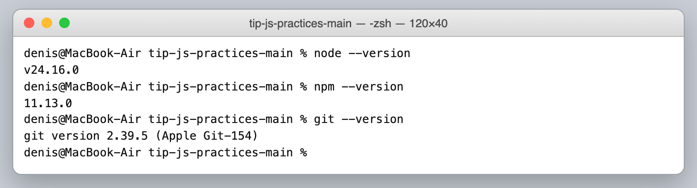

## 3. Запуск

Команды выполняются **из корня репозитория** `tip-js-practices-main`:

```bash
node practice-01/js/hello.js
node practice-01/js/types.js
node practice-01/js/progress.js
node practice-01/js/plan.js
node practice-01/js/debug.js
```

В браузере: открыть `practice-01/index.html`, в теге `<script src="./js/hello.js" defer>` при необходимости поменять имя файла (`types.js`, `progress.js`, …), сохранить, обновить страницу и открыть DevTools → **Console**. Одновременно подключается только один файл. Сейчас в `index.html` снова стоит `hello.js`.

## 4. Задание 1. Один файл — две среды

`hello.js` запускался двумя способами.

| Способ | Где виден вывод | Последняя строка |
|---|---|---|
| `node practice-01/js/hello.js` | в терминале | `Тип document: undefined` |
| `index.html` в Chrome | DevTools → Console (на самой странице только заголовок и два абзаца из HTML) | `Тип document: object` |

Первые четыре строки (студент, группа, номер работы, «JavaScript успешно запущен») одинаковые.

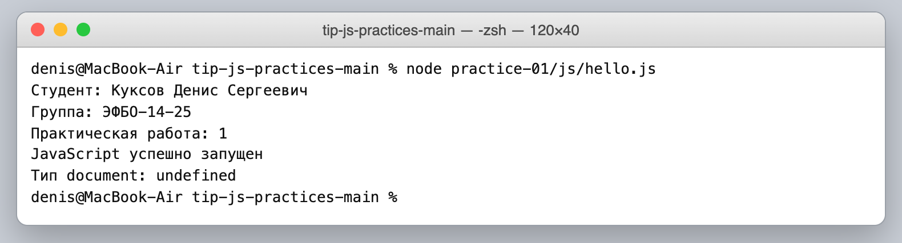

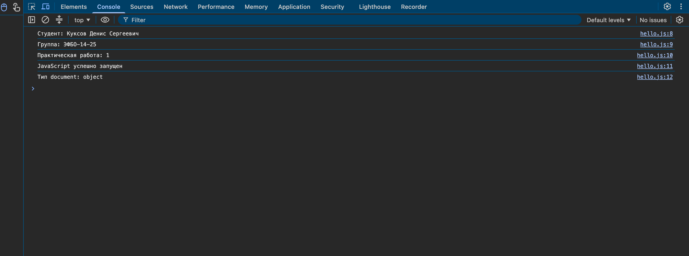

**Почему отличается `typeof document`.** JavaScript — один и тот же язык, а набор готовых объектов даёт среда выполнения. Браузер загружает HTML-страницу и предоставляет объект `document` для работы с ней (DOM), поэтому `typeof document` → `"object"`. Node.js запускает файл без всякой страницы, переменной `document` там просто нет, и `typeof` для необъявленного имени возвращает `"undefined"` (без ошибки — это особенность `typeof`).

## 5. Задание 2. Типы и преобразования

Сначала записал прогноз, потом запустил `node practice-01/js/types.js`. В файле значение и тип выводятся в одной строке через `/`, а строки показаны через `JSON.stringify`, чтобы были видны кавычки.

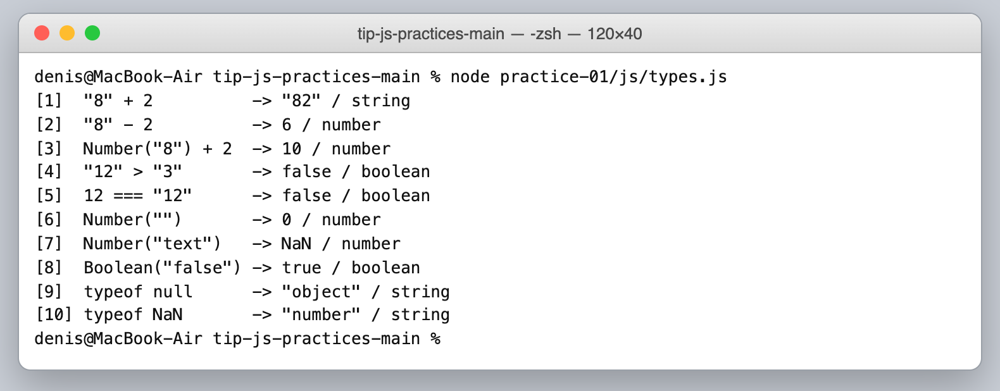

| № | Выражение | Мой прогноз до запуска | Фактическое значение | Тип результата | Объяснение |
|---:|---|---|---|---|---|
| 1 | `"8" + 2` | `"82"` | `"82"` | `string` | Совпало. Если один операнд `+` строка — второй тоже превращается в строку и они склеиваются. |
| 2 | `"8" - 2` | `6` | `6` | `number` | Совпало. У `-` нет «строкового» режима, поэтому `"8"` приводится к числу. |
| 3 | `Number("8") + 2` | `10` | `10` | `number` | Совпало. Строка явно превращена в число до сложения. |
| 4 | `"12" > "3"` | `true` | `false` | `boolean` | **Ошибся.** Обе стороны — строки, поэтому сравнение идёт посимвольно, как в словаре: первый символ `"1"` меньше `"3"`, дальше уже не смотрится. |
| 5 | `12 === "12"` | `false` | `false` | `boolean` | Совпало. Строгое равенство не приводит типы: число ≠ строка. |
| 6 | `Number("")` | `NaN` | `0` | `number` | **Ошибся.** Пустая строка (и строка из пробелов) по правилам `Number()` даёт `0`. Значит, пустой ввод может «притвориться» нулём. |
| 7 | `Number("text")` | `NaN` | `NaN` | `number` | Совпало. Строку нельзя разобрать как число; при этом `NaN` всё равно имеет тип `number`. |
| 8 | `Boolean("false")` | `false` | `true` | `boolean` | **Ошибся.** `Boolean` не читает смысл слова. Ложна только пустая строка, а `"false"` — непустая. |
| 9 | `typeof null` | `"object"` | `"object"` | `string` | Совпало (знал про эту историческую особенность). Само значение `null` — примитив, не объект. |
| 10 | `typeof NaN` | `"NaN"` | `"number"` | `string` | **Ошибся.** `NaN` — специальное значение числового типа. |

В строках 9 и 10 значение выражения — строка с названием типа (`"object"`, `"number"`), а тип самого результата — `string`, потому что `typeof` всегда возвращает строку.

Итого не совпали 4 прогноза из 10 (№ 4, 6, 8, 10), и все они про неявные преобразования, а не про арифметику. Файл одинаково работает в Node.js и в браузере.

## 6. Задания 3 и 4. Расчёты и проверки

### Задание 3 — `progress.js`

Решение проверяет сначала `totalTasks`, затем `completedTasks`; в каждом сообщении об ошибке написано, *какое именно* значение не прошло (`totalTasks должен быть целым числом` и т. п.). Порядок для каждого значения: тип → `NaN`/`Infinity` → целое → не меньше 0 → верхняя граница. Статус я определяю через остаток: остаток равен общему числу — «Не начато», остаток 0 — «Завершено», иначе — «В работе». Деления на ноль нет: случай `0 / 0` перехватывается раньше расчёта процента.

Чтобы прогнать проверки, менял значения в начале файла и перезапускал его, после проверок вернул данные варианта.

| Проверка | Входные данные | Ожидаемый результат | Фактический результат | Итог |
|---|---|---|---|---|
| Мой вариант | `15`, `0` | Осталось 15; 0.0%; «Не начато» | Осталось 15; Прогресс 0.0%; Статус: Не начато | Пройдено |
| Обычный случай | `12`, `5` | Осталось 7; 41.7%; «В работе» | Осталось 7; 41.7%; В работе | Пройдено |
| Граница: задач нет | `0`, `0` | «Задач пока нет», без процента | `Задач пока нет` | Пройдено |
| Граница: ничего не сделано | `5`, `0` | Осталось 5; 0.0%; «Не начато» | Осталось 5; 0.0%; Не начато | Пройдено |
| Граница: всё сделано | `5`, `5` | Осталось 0; 100.0%; «Завершено» | Осталось 0; 100.0%; Завершено | Пройдено |
| Некорректно | `5`, `6` | Ошибка | `Ошибка: выполненных задач больше, чем задач всего` | Пройдено |
| Некорректно | `-1`, `0` | Ошибка | `Ошибка: totalTasks не может быть отрицательным` | Пройдено |
| Некорректно | `5`, `2.5` | Ошибка | `Ошибка: completedTasks должен быть целым числом` | Пройдено |
| Некорректно | `"5"`, `2` | Ошибка | `Ошибка: totalTasks должен быть числом, получен тип string` | Пройдено |
| Некорректно | `1001`, `0` | Ошибка | `Ошибка: totalTasks больше допустимого максимума 1000` | Пройдено |
| Некорректно | `NaN`, `0` | Ошибка | `Ошибка: totalTasks — недопустимое числовое значение (NaN или Infinity)` | Пройдено |

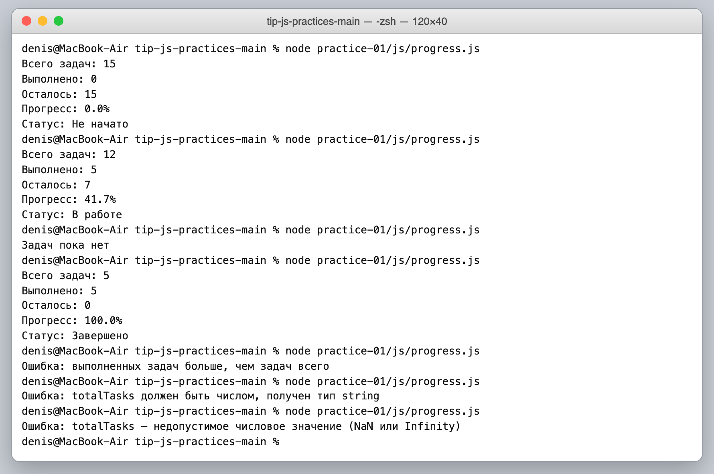

На скриншоте подряд: мой вариант (15, 0), затем (12, 5), (0, 0), (5, 5), (5, 6), ("5", 2), (NaN, 0).

### Задание 4 — `plan.js`

Проверки `totalTasks`/`completedTasks` те же, что в задании 3, после них — `dailyLimit` (целое от 1 до 1000; проверяется всегда, даже если задач не осталось). План строится циклом `while`. Вместо `Math.min` я выбираю количество на день через `if`: по умолчанию `dailyLimit`, но если осталось меньше нормы — берётся остаток. Поэтому остаток никогда не становится отрицательным.

| Проверка | Входные данные | Ожидаемый результат | Фактический результат | Итог |
|---|---|---|---|---|
| Мой вариант | `15`, `0`, `4` | 4 дня: 4, 4, 4, 3 | Осталось 15; дни 4 / 4 / 4 / 3; Потребуется дней: 4 | Пройдено |
| Обычный случай | `12`, `5`, `3` | 3 дня, в последний — 1 | дни 3 / 3 / 1; 3 дня | Пройдено |
| Ровное деление | `10`, `4`, `3` | 2 дня по 3 | дни 3 / 3; 2 дня | Пройдено |
| Норма больше остатка | `5`, `3`, `10` | 1 день, сделано 2 | День 1: выполнено 2, осталось 0; 1 день | Пройдено |
| Всё уже сделано | `5`, `5`, `2` | 0 дней, цикл не идёт | `Все задачи уже выполнены, планировать нечего`, `Потребуется дней: 0` | Пройдено |
| Задач нет | `0`, `0`, `2` | 0 дней, цикл не идёт | то же сообщение, 0 дней | Пройдено |
| Нулевая норма | `5`, `2`, `0` | Ошибка, цикл не запускается | `Ошибка: dailyLimit должен быть в диапазоне от 1 до 1000` | Пройдено |
| Дробная норма | `5`, `2`, `1.5` | Ошибка | `Ошибка: dailyLimit (дневная норма) должен быть целым числом` | Пройдено |
| Выполнено больше | `5`, `6`, `2` | Ошибка | `Ошибка: выполненных задач больше, чем задач всего` | Пройдено |
| Норма строкой | `5`, `2`, `"2"` | Ошибка | `Ошибка: dailyLimit должен быть числом, получен тип string` | Пройдено |
| Норма > 1000 | `5`, `2`, `1001` | Ошибка | `Ошибка: dailyLimit должен быть в диапазоне от 1 до 1000` | Пройдено |

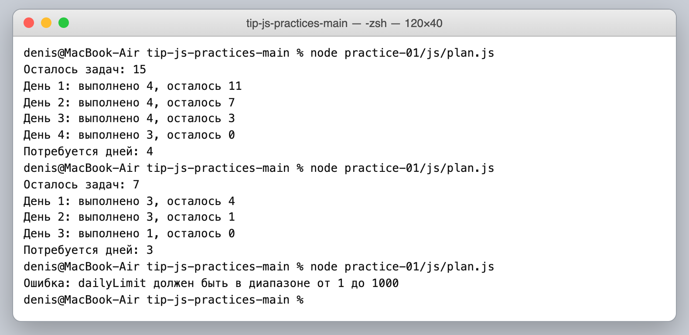

На скриншоте: мой вариант (15, 0, 4), общий пример (12, 5, 3) и ошибка при норме 0.

**Почему цикл не может зависнуть:** до цикла гарантировано `dailyLimit >= 1`, значит за каждую итерацию остаток уменьшается хотя бы на 1. Без проверки нормы при `dailyLimit = 0` остаток не уменьшался бы и цикл стал бы бесконечным.

## 7. Задание 5. Отладка

### Исходный вывод (с ошибками)

```text
Выполнено: 32
Осталось: -24
Контрольная сумма: 6
```

Исключения нет — программа «спокойно» печатает неправильные числа.

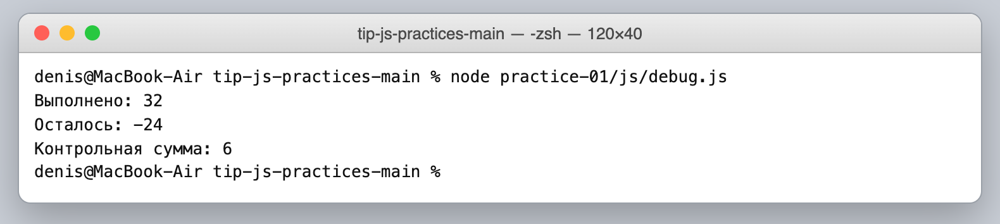

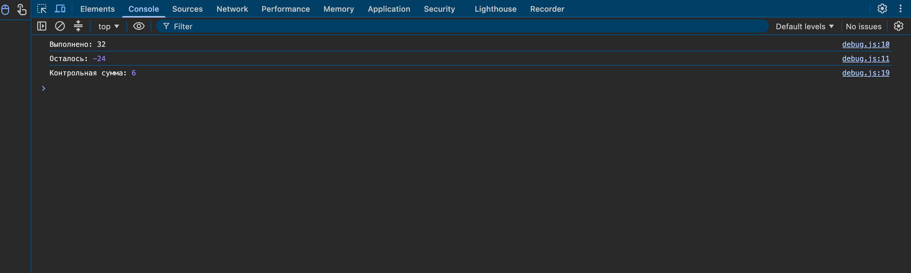

### Как искал ошибки

1. Подключил в `index.html` файл `./js/debug.js`, открыл DevTools → **Sources**, поставил точку останова на строке 7 (`const completedTotal = ...`) и обновил страницу.
2. Программа остановилась **до** выполнения строки 7. В **Scope** видно `completedText: "3"` и `additionalText: "2"` — значения в кавычках, т. е. строки; `completedTotal` ещё недоступен. Для наглядности добавил в **Watch** выражения `typeof completedText` → `"string"` и `completedText + additionalText` → `"32"`.

   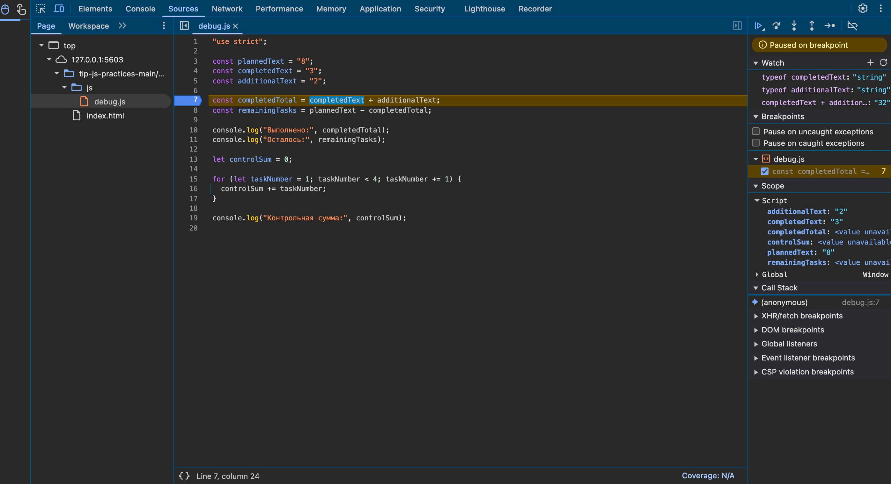

3. Нажал **Step over** — теперь программа стоит на строке 8, а `completedTotal` уже равно `"32"`, тип `string`. Это и есть первая причина.

   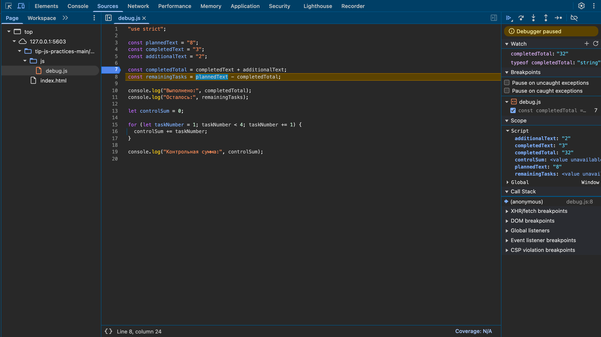

4. Поставил условную точку останова внутри цикла (строка 16, условие `taskNumber === 3`), чтобы сразу попасть на последнюю итерацию. В Watch: `taskNumber = 3`, `controlSum = 3`, `taskNumber < 4` → `true`. После этой итерации `taskNumber` станет 4, условие `4 < 4` ложно, и номер 4 так и не прибавится — итог 1 + 2 + 3 = 6.

   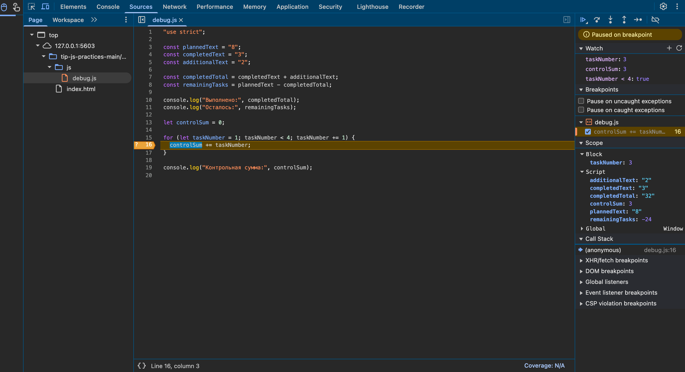

5. Исправил обе причины (без подстановки готовых чисел), снял точки останова и проверил в Node.js и браузере.

| Ошибка | Что наблюдалось | Причина | Исправление | Результат после исправления |
|---|---|---|---|---|
| Обработка количества задач | `Выполнено: 32`, `Осталось: -24` | Исходные данные — строки, `"3" + "2"` склеивает текст в `"32"`. Потом `"8" - "32"` уже вычитает числа: `8 - 32 = -24` | `Number(completedText) + Number(additionalText)` и `Number(plannedText) - completedTotal` | `Выполнено: 5`, `Осталось: 3` |
| Граница цикла | `Контрольная сумма: 6` | Условие `taskNumber < 4` не пропускает номер 4 | Условие `taskNumber <= 4` | `Контрольная сумма: 10` |

### Вывод после исправления

```text
Выполнено: 5
Осталось: 3
Контрольная сумма: 10
```

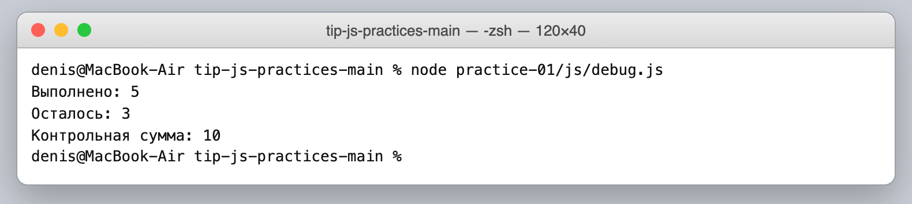

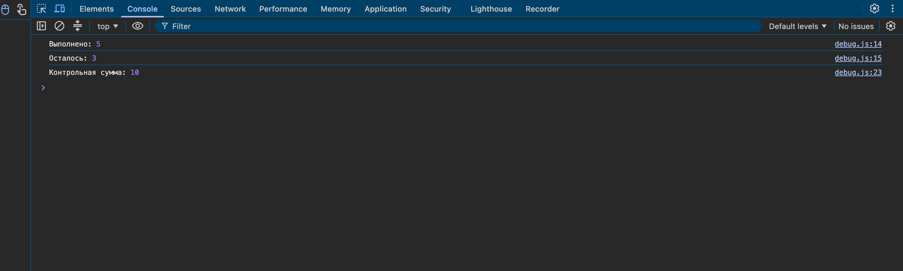

В репозитории `debug.js` хранится уже в исправленном виде, исходные строки с ошибками описаны в комментарии в начале файла и в этом разделе.

## 8. Вывод

- Настроил окружение (Node.js 24 LTS, npm, Git, Chrome) и понял разницу между языком и средой выполнения: один и тот же файл работает и в Node.js, и в браузере, но `document` есть только во втором.
- Разобрался с типами и неявными преобразованиями — 4 моих прогноза из 10 оказались неверными, все на преобразованиях (`"12" > "3"`, `Number("")`, `Boolean("false")`, `typeof NaN`).
- Сделал проверку входных данных «от типа к границам» и убедился, что одного `typeof value === "number"` мало: `NaN` и `2.5` тоже числа.
- Построил план по дням циклом `while` и обосновал, почему он всегда заканчивается.
- Научился ставить обычные и условные точки останова, смотреть Scope/Watch и делать Step over.

**Самая показательная ошибка** — `"3" + "2" = "32"` в `debug.js`. Программа не падает, а значит, без проверки результата или отладчика ошибку легко пропустить. В отладчике её выдают кавычки у значений в Scope: виноват не код сложения, а тип данных.
