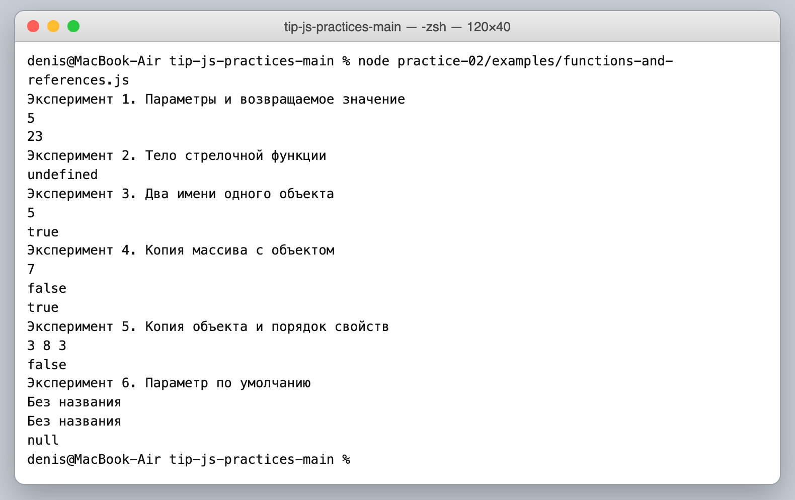
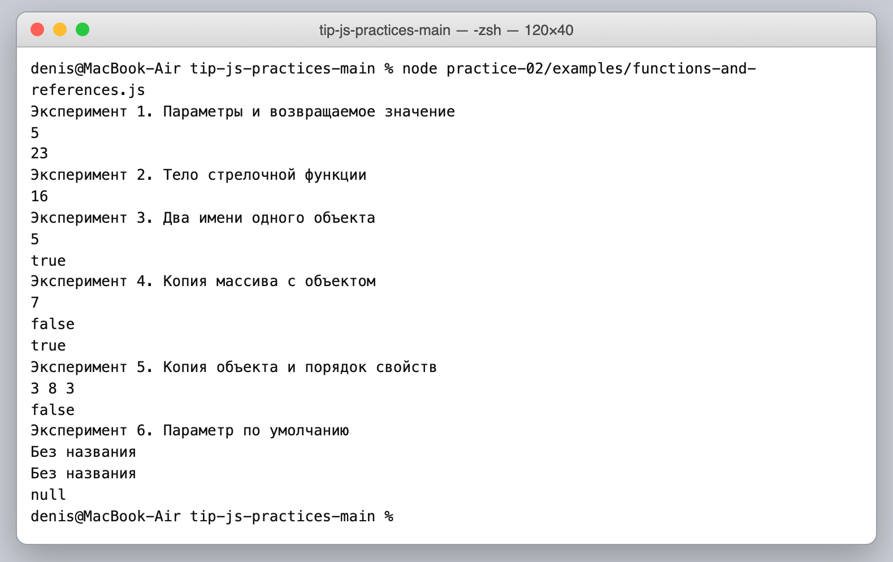
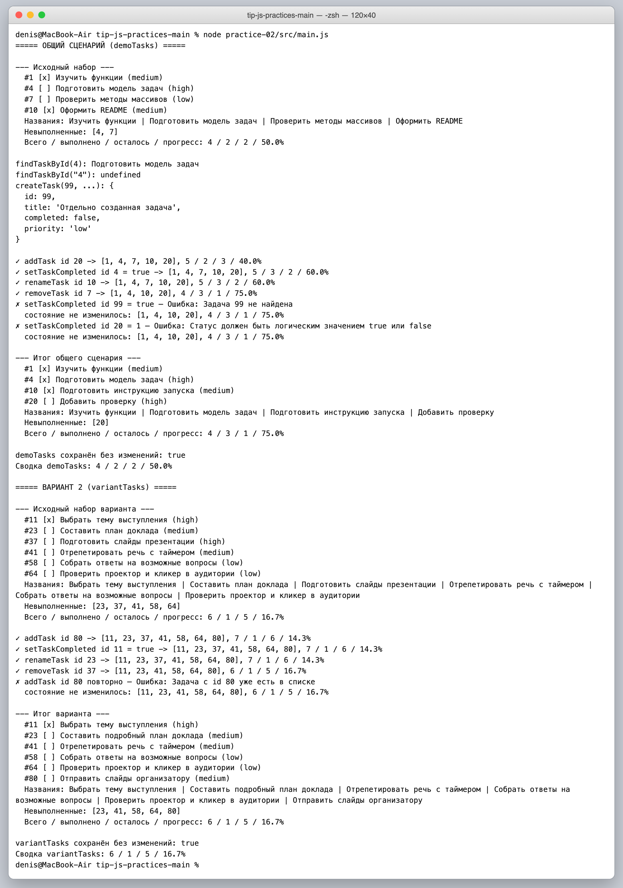
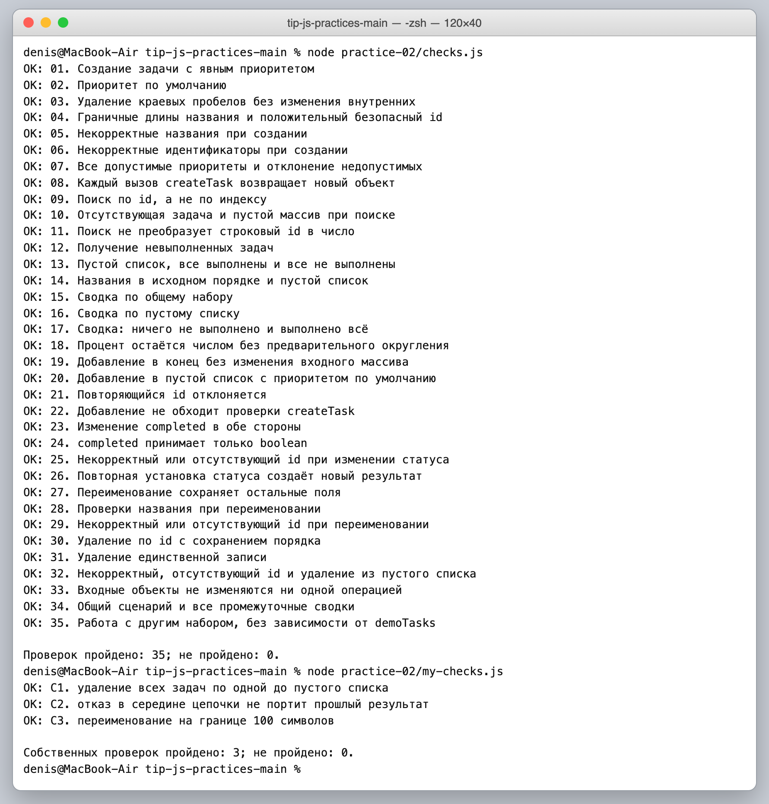

# Отчёт по практической работе № 2

**Тема:** Функции, объекты, массивы и организация кода

## 1. Автор и окружение

**Имя:** Куксов Денис Сергеевич  
**Группа:** ЭФБО-14-25  
**Вариант:** 2 (подготовка выступления)  
**Операционная система:** macOS 27.0  
**Node.js:** v24.16.0  
**npm:** 11.13.0

## 2. Запуск

Из корня личного репозитория:

```bash
node practice-02/examples/functions-and-references.js
node practice-02/src/main.js
node practice-02/checks.js
```

Альтернатива — из папки `practice-02`:

```bash
npm run examples
npm start
npm run check
```

Зависимостей нет; `npm install` не требуется.

Собственные проверки лежат в отдельном файле (готовый `checks.js` оставлен без изменений):

```bash
node practice-02/my-checks.js
```

## 3. Функции, ссылки и копирование

Прогноз заполняется до первого запуска. Для эксперимента 2 необходимо
сохранить исходный результат и отдельно указать результат после исправления.

| № | Прогноз до запуска | Фактический результат | Причина |
|---:|---|---|---|
| 1 | `5` и `5` — думал, что `"2"` станет числом | `5` (number) и `23` (string) | **Не совпало.** Функция `sum` просто делает `a + b` и сама ничего не приводит. Для `"2" + 3` оператор `+` видит строку и склеивает: `"23"`. |
| 2 | `16` | до исправления `undefined`, после — `16` | **Не совпало** с исходным кодом: я не заметил, что в теле в `{ }` нет `return`. Выражение `value * value` вычисляется и пропадает, функция возвращает `undefined`. Автоматический возврат есть только у краткой записи без скобок. |
| 3 | `5` и `true` | `5` и `true` | Совпало. `alias = product` копирует ссылку, а не объект: обе переменные указывают на один объект, поэтому изменение через `alias` видно в `product`. |
| 4 | `7`, `false`, `true` | `7`, `false`, `true` | Совпало. `[...products]` — новый массив (`products === copy` → `false`), но элемент внутри тот же объект (`products[0] === copy[0]` → `true`), поэтому `copy[0].stock = 7` меняет и оригинал. |
| 5 | `3 8 8` и `false` | `3 8 3` и `false` | **Частично не совпало.** Я считал, что явно написанное `stock: 8` всегда «главнее». На деле побеждает то, что записано последним: в `{ stock: 8, ...product }` spread идёт после и возвращает `3`. Новый объект от spread — другой объект, поэтому `product === first` → `false`. |
| 6 | `Без названия` ×3 и пустая строка — думал, что `null` тоже заменится | `Без названия`, `Без названия`, `null`, пустая строка | **Не совпало** для `null`. Значение по умолчанию подставляется только когда аргумента нет или он `undefined`. `null` и `""` — переданные значения, они возвращаются как есть. |

**Исправление эксперимента 2:** в стрелочной функции с телом в фигурных скобках добавлен `return value * value;` (рядом оставлен комментарий из заготовки и пометка об исправлении). До исправления `square(4)` выводил `undefined`, после — `16`.





## 4. Модель данных и функции

Кратко описать поля задачи, правила валидации и назначение файлов.
Для каждой операции указать, какой результат возвращается при успехе и ошибке.
Не требуется дублировать весь исходный код.

**Поля задачи:** `id` — положительное безопасное целое (`typeof id === "number"`, `Number.isSafeInteger`, `> 0`; строка `"4"` не превращается в `4`); `title` — строка, после `trim()` длиной 1…100, сохраняется очищенной; `completed` — `true`/`false`, у новой задачи всегда `false`; `priority` — строго `"low"`, `"medium"` или `"high"`, по умолчанию `"medium"`.

**Файлы:**

| Файл | Назначение |
|---|---|
| `src/data.js` | только данные: `demoTasks`, `variantNumber = 2`, `variantTasks` |
| `src/task-service.js` | девять экспортируемых функций + внутренние `fail`, `checkId`, `checkTitle`, `updateTask`; без `console.log` и без глобального списка |
| `src/main.js` | порядок действий и вывод; вспомогательные `formatStats`, `idsOf`, `showState`, `step` только печатают |
| `checks.js` | готовые 35 проверок (без изменений) |
| `my-checks.js` | мои 3 проверки |

**Особенности моей реализации:**

- общая внутренняя функция `updateTask(tasks, id, changes)` используется и в `setTaskCompleted`, и в `renameTask`: она проверяет, что задача есть, и делает `tasks.map(...)` с `{ ...task, ...changes }` только для нужной записи;
- `getTaskStats` считает выполненные как `total - getPendingTasks(tasks).length`, то есть переиспользует уже проверенную функцию отбора;
- `addTask` сначала создаёт задачу через `createTask` (все проверки полей), и только потом проверяет уникальность `id`.

| Функция | Успех | Ошибка / отсутствие |
|---|---|---|
| `createTask(id, title, priority)` | `{ ok: true, task }` — новый объект | `{ ok: false, error }` |
| `findTaskById(tasks, id)` | найденный объект (через `find`) | `undefined` |
| `getPendingTasks(tasks)` | новый массив невыполненных (через `filter`) | — (пустой массив тоже результат) |
| `getTaskTitles(tasks)` | новый массив названий (через `map`) | — |
| `getTaskStats(tasks)` | `{ total, completed, pending, progress }`, `progress` без округления; для `[]` всё `0` | — |
| `addTask(tasks, id, title, priority)` | `{ ok: true, tasks: [...tasks, task] }` | ошибки `createTask` или «Задача с id … уже есть в списке» |
| `setTaskCompleted(tasks, id, completed)` | `{ ok: true, tasks }` (через `updateTask`) | неверный `id`, статус не `true`/`false`, задача не найдена |
| `renameTask(tasks, id, title)` | `{ ok: true, tasks }` (через `updateTask`) | неверный `id`, неверное название, задача не найдена |
| `removeTask(tasks, id)` | `{ ok: true, tasks }` через `filter` | неверный `id`, задача не найдена |

**Почему id не равен индексу:** индекс — это текущая позиция в массиве, она меняется после удаления соседей. `id` — постоянное имя записи. В `demoTasks` задача `id = 4` стоит на индексе `1`, а `tasks[4]` вообще `undefined`. Поэтому поиск везде идёт `find` по полю `id`.  
**Почему getTaskStats возвращает число, а не строку с процентом:** сводка — это данные, с ними дальше считают и сравнивают (в проверках, а в ПР3 — в интерфейсе). `toFixed(1)` возвращает строку, поэтому округление делается только при выводе в `main.js`; там же для пустого списка вместо процента пишется «Задач пока нет».  
**Какие объекты копируются при изменении задачи:** создаются новый массив и новый объект только изменяемой задачи; остальные объекты переносятся в новый массив по ссылке без изменений. `push`, `splice` и присваивания свойствам входных объектов нигде не используются.

## 5. Общий демонстрационный сценарий

Ожидания приведены в методичке. Столбец фактических результатов заполняется после запуска.

| Этап | Ожидание: всего / выполнено / осталось / прогресс | Фактический результат | Итог |
|---|---|---|---|
| Исходный набор | 4 / 2 / 2 / 50.0% | 4 / 2 / 2 / 50.0% | Пройдено |
| Добавление id 20 | 5 / 2 / 3 / 40.0% | 5 / 2 / 3 / 40.0% | Пройдено |
| Выполнение id 4 | 5 / 3 / 2 / 60.0% | 5 / 3 / 2 / 60.0% | Пройдено |
| Переименование id 10 | 5 / 3 / 2 / 60.0% | 5 / 3 / 2 / 60.0% | Пройдено |
| Удаление id 7 | 4 / 3 / 1 / 75.0% | 4 / 3 / 1 / 75.0% | Пройдено |

**Идентификаторы итогового списка:** `[1, 4, 10, 20]`, невыполненная — только `id = 20`.  
**Показанная ошибка и состояние после неё:** показаны два отказа — `setTaskCompleted(tasks, 99, true)` → `Ошибка: Задача 99 не найдена` и `setTaskCompleted(tasks, 20, 1)` → `Ошибка: Статус должен быть логическим значением true или false`. После каждого выводится «состояние не изменилось: [1, 4, 10, 20], 4 / 3 / 1 / 75.0%», потому что функция `step` в `main.js` заменяет состояние только при `result.ok === true`.  
**Подтверждение неизменности demoTasks:** в начале сохранён `JSON.stringify(demoTasks)`, в конце он сравнивается с текущим: `demoTasks сохранён без изменений: true`, сводка `demoTasks` по-прежнему 4 / 2 / 2 / 50.0%.



## 6. Проверки

**Команда запуска:** `node practice-02/checks.js` из корня репозитория (или `npm run check` из `practice-02`); собственные — `node practice-02/my-checks.js`.  
**Фактически пройдено проверок:** 35 из 35 в `checks.js` и 3 из 3 в `my-checks.js`.  
**Дата запуска и версия Node.js:** 11.10.2026, Node.js v24.16.0.

```text
OK: 01. Создание задачи с явным приоритетом
OK: 02. Приоритет по умолчанию
OK: 03. Удаление краевых пробелов без изменения внутренних
OK: 04. Граничные длины названия и положительный безопасный id
OK: 05. Некорректные названия при создании
OK: 06. Некорректные идентификаторы при создании
OK: 07. Все допустимые приоритеты и отклонение недопустимых
OK: 08. Каждый вызов createTask возвращает новый объект
OK: 09. Поиск по id, а не по индексу
OK: 10. Отсутствующая задача и пустой массив при поиске
OK: 11. Поиск не преобразует строковый id в число
OK: 12. Получение невыполненных задач
OK: 13. Пустой список, все выполнены и все не выполнены
OK: 14. Названия в исходном порядке и пустой список
OK: 15. Сводка по общему набору
OK: 16. Сводка по пустому списку
OK: 17. Сводка: ничего не выполнено и выполнено всё
OK: 18. Процент остаётся числом без предварительного округления
OK: 19. Добавление в конец без изменения входного массива
OK: 20. Добавление в пустой список с приоритетом по умолчанию
OK: 21. Повторяющийся id отклоняется
OK: 22. Добавление не обходит проверки createTask
OK: 23. Изменение completed в обе стороны
OK: 24. completed принимает только boolean
OK: 25. Некорректный или отсутствующий id при изменении статуса
OK: 26. Повторная установка статуса создаёт новый результат
OK: 27. Переименование сохраняет остальные поля
OK: 28. Проверки названия при переименовании
OK: 29. Некорректный или отсутствующий id при переименовании
OK: 30. Удаление по id с сохранением порядка
OK: 31. Удаление единственной записи
OK: 32. Некорректный, отсутствующий id и удаление из пустого списка
OK: 33. Входные объекты не изменяются ни одной операцией
OK: 34. Общий сценарий и все промежуточные сводки
OK: 35. Работа с другим набором, без зависимости от demoTasks

Проверок пройдено: 35; не пройдено: 0.
```

```text
OK: С1. удаление всех задач по одной до пустого списка
OK: С2. отказ в середине цепочки не портит прошлый результат
OK: С3. переименование на границе 100 символов

Собственных проверок пройдено: 3; не пройдено: 0.
```



Три собственные проверки обязательны; они дополняют, а не заменяют общий сценарий.

| Проверка | Входные данные | Ожидаемый результат | Фактический результат | Итог |
|---|---|---|---|---|
| Собственная проверка 1 (С1) | Общий набор, удалить по очереди `10`, `1`, `7`, `4`, затем ещё раз удалить `4` | Списки `[1, 4, 7]` → `[4, 7]` → `[4]` → `[]`; сводка пустого списка `0 / 0 / 0 / 0`; `getPendingTasks([])` → `[]`; повторное удаление — отказ; исходный набор цел | Совпало со всеми ожиданиями | Пройдено |
| Собственная проверка 2 (С2) | Переименовать `id 7`, затем две ошибки: `addTask(…, 30, …, "urgent")` и `setTaskCompleted(…, 7, "true")`, потом выполнить `id 7` | Оба вызова — `ok: false`, массив после переименования не изменился; дальше цепочка продолжается: `{ id: 7, title: "Разобрать find, filter и map", completed: true, priority: "low" }`, сводка 4 / 3 / 1 / 75 | Совпало | Пройдено |
| Собственная проверка 3 (С3) | `renameTask(…, 4, "   " + "Т"×100 + "   ")`, затем название из 101 символа и из одних пробелов | 100 символов после `trim()` принимаются, `completed: false` и `priority: "high"` сохранены; 101 символ и пробелы — отказ, прежнее название остаётся | Совпало | Пройдено |

С1 проверяет граничное состояние «список опустел», С2 — что отказ не ломает уже полученное состояние, С3 — точную границу длины именно при переименовании (в готовых проверках граница проверяется при создании).

## 7. Индивидуальный вариант

**Предметная область набора задач:** вариант 2 — подготовка выступления. K = 1 (выполнена только первая задача), новая задача `id = 80` имеет приоритет `medium`.  
**Исходные данные:** [`src/data.js`](./src/data.js), массив `variantTasks`: `11` «Выбрать тему выступления» (high, выполнена), `23` «Составить план доклада» (medium), `37` «Подготовить слайды презентации» (high), `41` «Отрепетировать речь с таймером» (medium), `58` «Собрать ответы на возможные вопросы» (low), `64` «Проверить проектор и кликер в аудитории» (low).

Ожидания посчитал до запуска (1 из 6 = 16.7%, совпадает с таблицей методички):

| Этап | Ожидание до запуска | Фактический результат | Итог |
|---|---|---|---|
| Шесть исходных задач | 6 / 1 / 5 / 16.7%; невыполненные `[23, 37, 41, 58, 64]` | 6 / 1 / 5 / 16.7%; невыполненные `[23, 37, 41, 58, 64]` | Пройдено |
| Добавление id 80 | 7 / 1 / 6 / 14.3% (1 / 7) | 7 / 1 / 6 / 14.3% | Пройдено |
| Установка completed = true для id 11 | Задача уже выполнена — по контракту успех, числа те же: 7 / 1 / 6 / 14.3% | Успех, 7 / 1 / 6 / 14.3% | Пройдено |
| Переименование id 23 | «Составить подробный план доклада», `completed: false` и `medium` сохраняются; 7 / 1 / 6 / 14.3% | Название изменено, остальные поля прежние; 7 / 1 / 6 / 14.3% | Пройдено |
| Удаление id 37 | Уходит невыполненная задача: 6 / 1 / 5 / 16.7% | 6 / 1 / 5 / 16.7% | Пройдено |
| Повторное добавление id 80 | Отказ, список не меняется: 6 / 1 / 5 / 16.7% | `Ошибка: Задача с id 80 уже есть в списке`; 6 / 1 / 5 / 16.7% | Пройдено |

Итоговые идентификаторы: `[11, 23, 41, 58, 64, 80]`. В конце выводится `variantTasks сохранён без изменений: true` и исходная сводка 6 / 1 / 5 / 16.7%. Общий сценарий и вариант запускаются одной командой `node practice-02/src/main.js` (скриншот в разделе 5).

## 8. Расширение

Не выполнялось.

## 9. Вывод

По сравнению с ПР1 расчёты больше не сидят в отдельных переменных: задача — объект, список — массив, операции — функции в отдельном модуле. Функции `task-service.js` ничего не печатают, а возвращают значения (объект, массив, сводку или `{ ok, error }`), поэтому один и тот же модуль без изменений используют `main.js`, `checks.js` и `my-checks.js`, а в ПР3 его можно будет вызывать из обработчиков на странице.

Неизменность данных проверял трижды: готовой проверкой 33 (с замороженными объектами), снимком `JSON.stringify` для `demoTasks` и `variantTasks` в конце `main.js` и собственной проверкой С2, где после отказов промежуточный массив сравнивается со своей копией.

Исправленная ошибка — пропущенный `return` в стрелочной функции с фигурными скобками (эксперимент 2). Больше всего пользы дал эксперимент 5: порядок свойств при spread важен, поэтому в `updateTask` изменения `...changes` стоят **после** `...task`, иначе новое значение затёрлось бы старым.

## 10. Самопроверка

- [x] Все девять функций реализованы; заглушек в `src/task-service.js` не осталось.
- [x] Общий и индивидуальный сценарии запускаются без ручной правки исходных данных.
- [x] Пройдены проверки, включая ошибки и сохранность входных объектов.
- [x] Фактические результаты не подменены ожидаемыми.
- [x] Инструкция запуска проверена из указанной рабочей папки.
- [ ] Код и отчёт отправлены в существующий учебный репозиторий.
