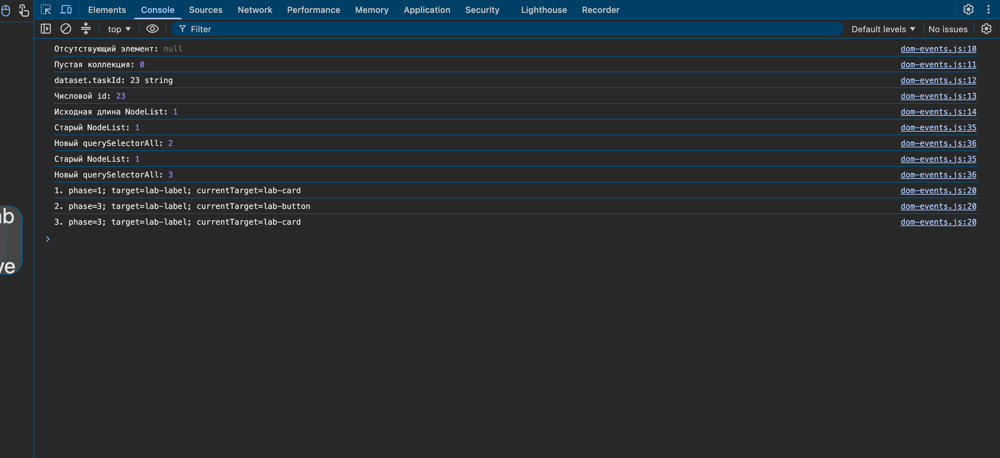
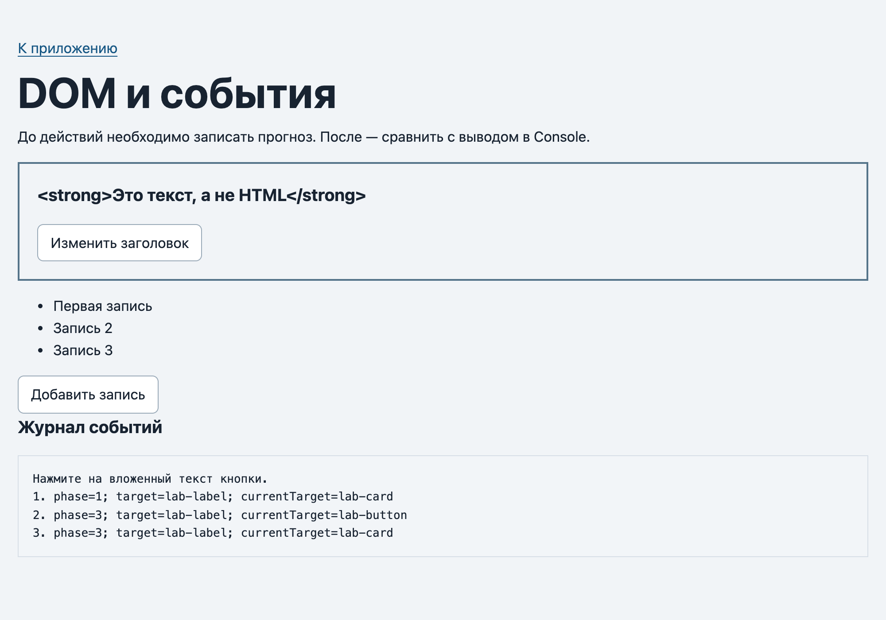
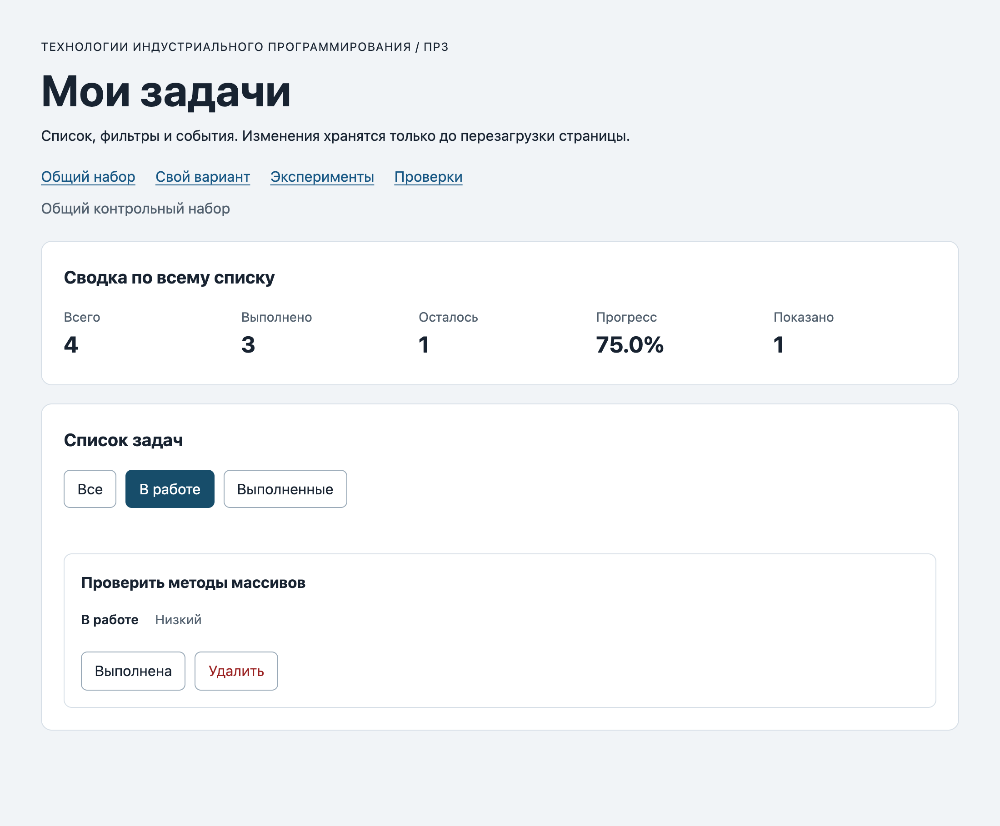
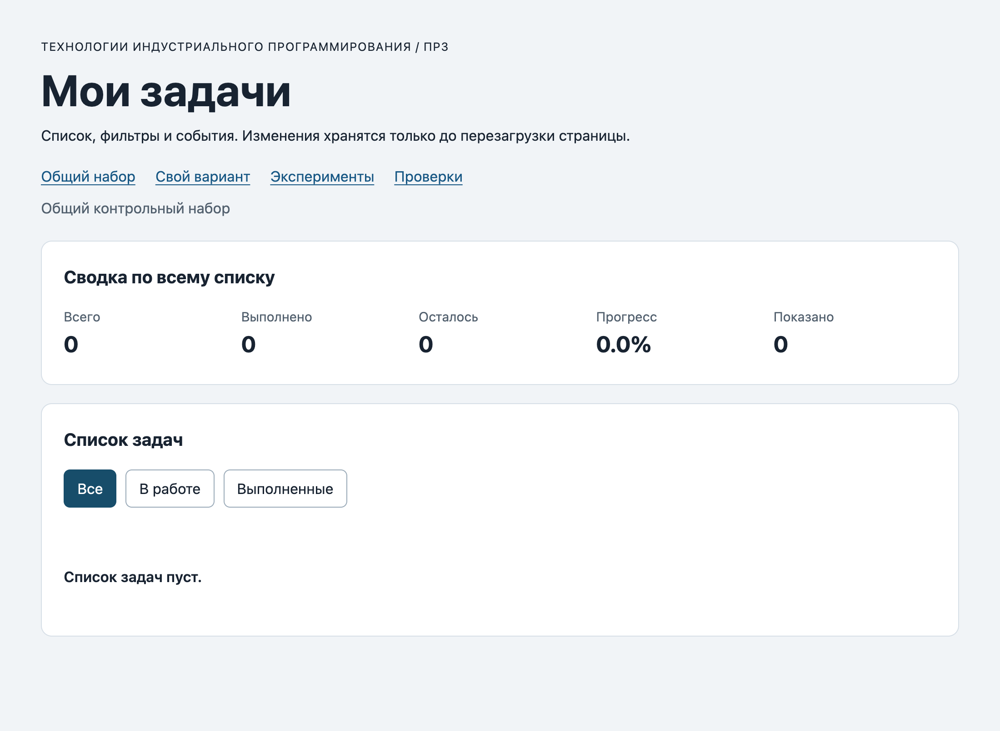
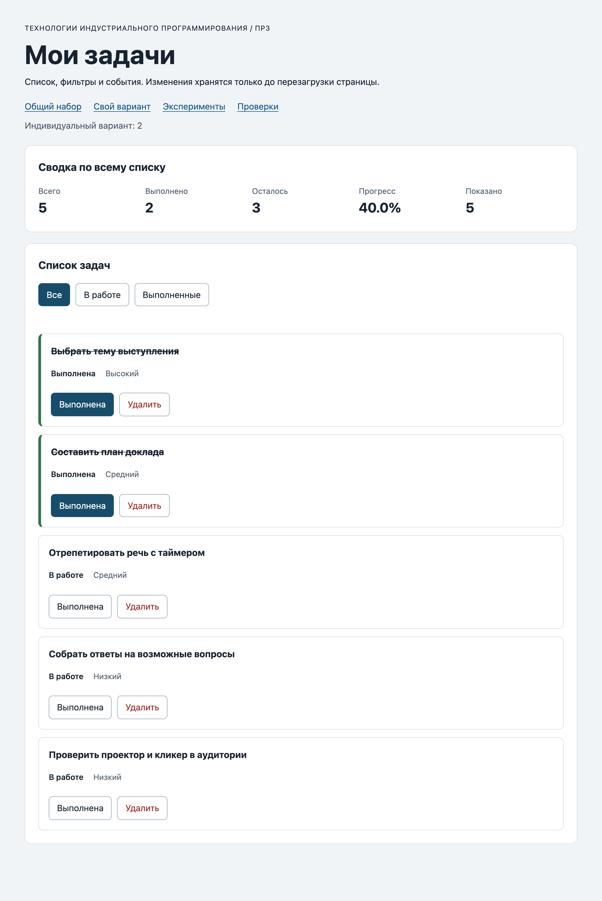
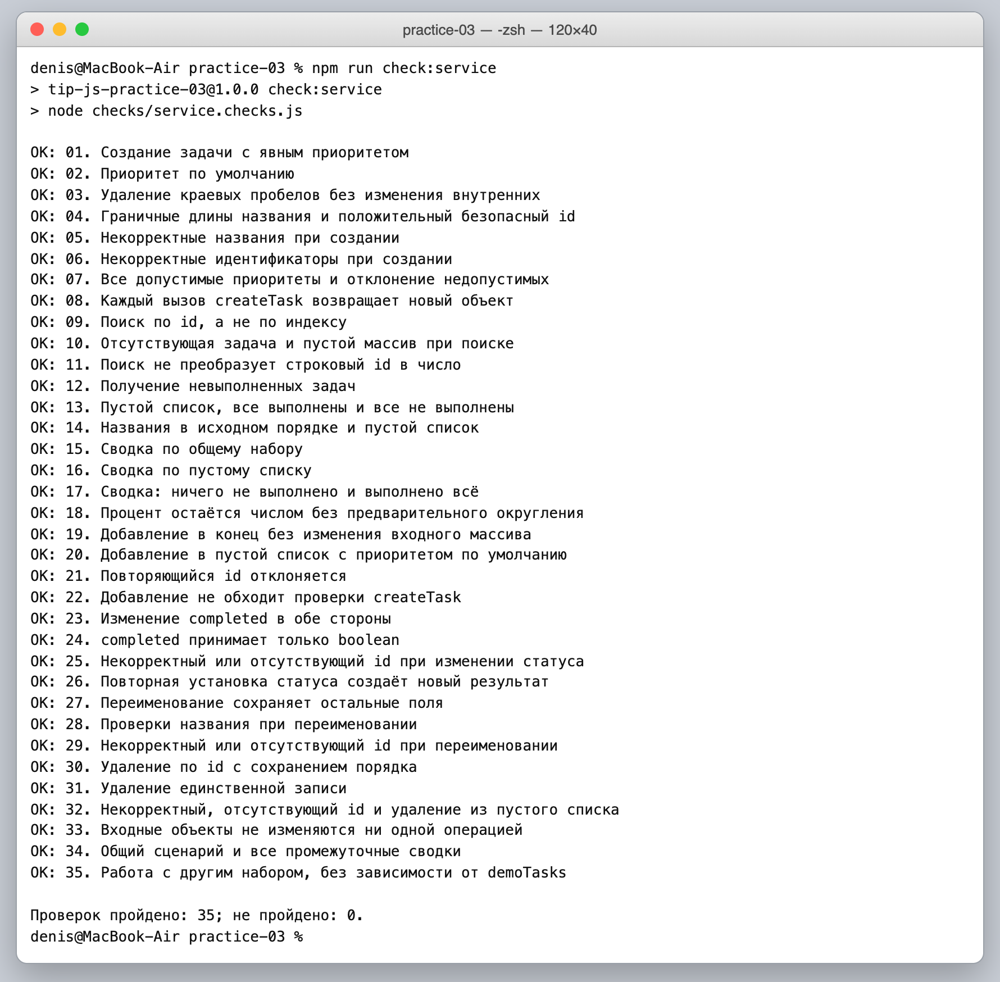
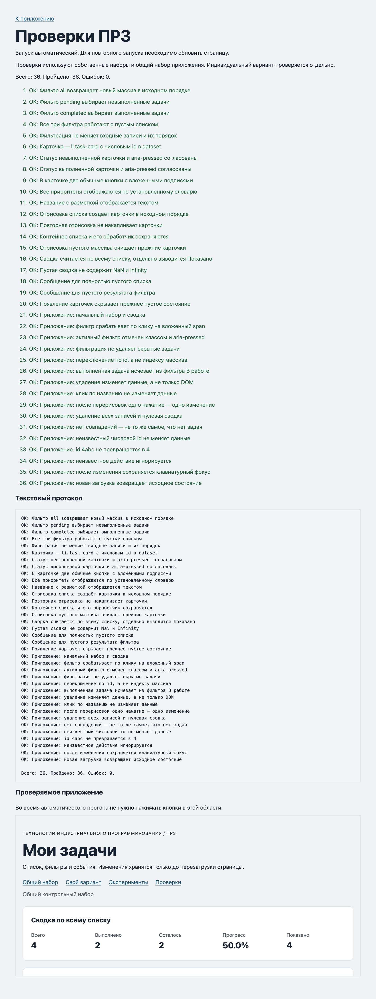
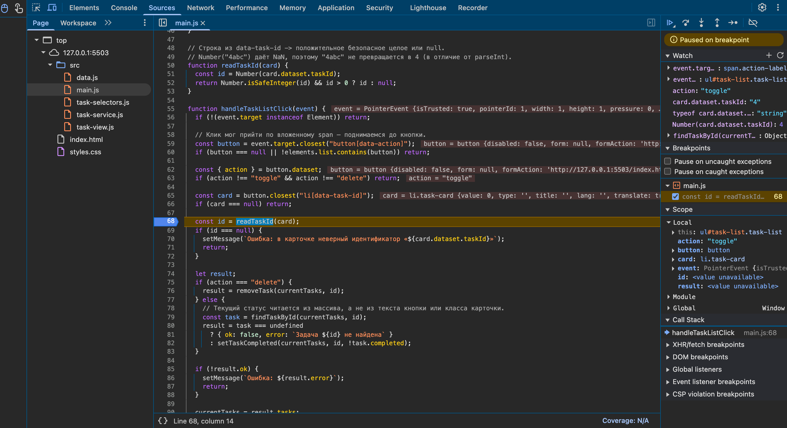
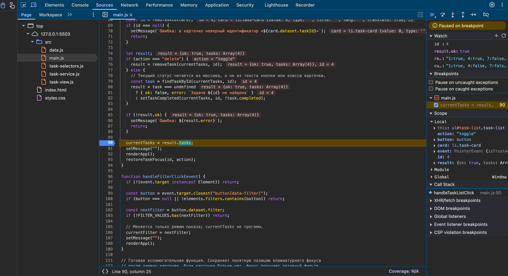

# Практическая работа № 3. Работа с DOM и событиями

## Данные работы

| Поле | Значение |
|---|---|
| Имя | Куксов Денис Сергеевич |
| Группа | ЭФБО-14-25 |
| Вариант из ПР2 | 2 — подготовка выступления |
| Node.js | v24.16.0 (npm 11.13.0) |
| Браузер | Google Chrome 154.0.8037.98 |
| Операционная система | macOS 27.0 |

## Запуск

Рабочая папка: `practice-03` внутри личного репозитория.

```bash
npm run check:service
npm start
```

Устанавливать зависимости через `npm install` не требуется. Из корня репозитория то же самое: `node practice-03/checks/service.checks.js` и `node practice-03/tools/serve.mjs`.

```text
http://127.0.0.1:5503/
http://127.0.0.1:5503/index.html?dataset=variant
http://127.0.0.1:5503/examples/dom-events.html
http://127.0.0.1:5503/checks.html
```

Остановка сервера: `Ctrl+C`. Использовался порт по умолчанию 5503. Двойной щелчок по `index.html` (`file://`) не подходит — страница подключает ES-модуль.

## Что перенесено из ПР2

`src/task-service.js` и `src/data.js` скопированы из `practice-02/src/` без изменений (девять функций и `variantTasks` варианта 2). Остальные файлы взяты из стартового комплекта; готовые файлы (`index.html`, `styles.css`, `checks.html`, `checks/*`, `examples/*`, `tools/serve.mjs`, `package.json`, `.gitignore`) не менялись. В `src/main.js` заменены только заглушки трёх функций, готовые части (переключение набора, `restoreTaskFocus`, подписки, `try/catch` старта) оставлены как были.

Повторная проверка копии: `npm run check:service` → **35 из 35**, исправлять перенесённый код не пришлось.

## Эксперименты

Страница `examples/dom-events.html`. Действия: дважды «Добавить запись», затем нажатие именно на текст «Изменить заголовок» (вложенный `span#lab-label`). Значения взяты из Console и журнала на странице.





| № | До запуска: прогноз | После запуска: результат | Объяснение |
|---:|---|---|---|
| 1. Отсутствующий элемент и коллекция | `null` и `0` | `Отсутствующий элемент: null`, `Пустая коллекция: 0` | Совпало. `querySelector` без совпадений даёт `null` (к его свойствам обращаться нельзя — будет `TypeError`), а `querySelectorAll` всегда даёт `NodeList`, просто пустой, у него есть `length`. |
| 2. dataset и числовой id | `23` типа `number` — думал, что `data-task-id="23"` уже число | `dataset.taskId: 23 string`, `Числовой id: 23` | **Не совпало.** Все значения `dataset` — строки (атрибут HTML всегда текст), `data-task-id` превращается в свойство `taskId`. Число получается только после `Number(...)`. |
| 3. Статический NodeList | сохранённый `initialItems` вырастет до 3 | исходно `1`; после 1-го нажатия старый `1`, новый `2`; после 2-го — старый `1`, новый `3` | **Не совпало.** `querySelectorAll` возвращает статический снимок на момент вызова. В документе `li` добавились, а сохранённая коллекция осталась прежней — нужен новый запрос. |
| 4. Строка с HTML-разметкой | заголовок станет жирным словом | в заголовке видно `<strong>Это текст, а не HTML</strong>` с угловыми скобками; у `h2` `children.length = 0`, `strong` внутри нет | **Не совпало.** `textContent` записывает строку как текст и не разбирает HTML. Поэтому названия задач выводятся через `textContent`. |
| 5. Распространение события | сначала обработчик кнопки, потом карточки (про захват не подумал) | `1. phase=1; target=lab-label; currentTarget=lab-card`<br>`2. phase=3; target=lab-label; currentTarget=lab-button`<br>`3. phase=3; target=lab-label; currentTarget=lab-card` | **Частично.** Первым срабатывает обработчик карточки, назначенный с `capture: true` (фаза 1 — захват). `target` всё время `span` — исходная цель, а `currentTarget` — тот, чей обработчик работает. Обработчик кнопки идёт в фазе 3 (всплытие), потому что нажали на её потомка. Так обработчик контейнера получает клики по любым вложенным элементам — на этом и держится делегирование. |

## Организация кода

Кратко описать `task-service.js`, `task-selectors.js`, `task-view.js` и `main.js`.
Указать, где хранятся полный список и фильтр, где обрабатывается событие и где вычисляется сводка.

| Файл | Что делает |
|---|---|
| `task-service.js` | функции ПР2 без изменений; DOM не использует |
| `task-selectors.js` | `getVisibleTasks(tasks, filter)` — таблица правил `FILTER_RULES` (`all` → всегда `true`, `pending` → `completed === false`, `completed` → `completed === true`) и один вызов `tasks.filter(rule)`. `filter` всегда возвращает новый массив, поэтому и для «Все» получается копия |
| `task-view.js` | маленькая фабрика `makeElement(tag, class, text)` (текст только через `textContent`) и `makeActionButton`; `createTaskElement` собирает `li.task-card[data-task-id]` с `h3.task-title`, `.task-status`, `.task-priority` и двумя кнопками в `.task-actions`; `renderTaskList` — `replaceChildren(...tasks.map(createTaskElement))`; `renderSummary` обходит все `[data-stat]` и берёт значения из `getTaskStats(tasks)`; `renderEmptyState` выбирает один из двух текстов и ставит `hidden` |
| `main.js` | состояние и события: `renderApp`, `readTaskId`, `handleTaskListClick`, `handleFilterClick` |

**Где что хранится:** полный список — `currentTasks`, фильтр — `currentFilter` (обе переменные в `main.js`). Видимая выборка не хранится — она каждый раз считается в `renderApp`. Клики по карточкам обрабатывает один делегированный `handleTaskListClick` на `ul#task-list`, клики по фильтрам — `handleFilterClick` на `#task-filters`; подписки сделаны один раз. Сводка считается функцией ПР2 `getTaskStats(currentTasks)` внутри `renderSummary`, «Показано» — длина видимой выборки.

**Путь одного нажатия «Выполнена»:** клик по `span.action-label` → всплытие до `ul#task-list` → `closest("button[data-action]")` → проверка `contains` и действия → `closest("li[data-task-id]")` → `readTaskId(card)` (строка → `Number` → `isSafeInteger && > 0`, иначе `null`) → `findTaskById` берёт текущий статус из массива → `setTaskCompleted(currentTasks, id, !task.completed)` → при `ok` новый массив в `currentTasks`, очистка сообщения, `renderApp()`, `restoreTaskFocus(id, action)`; при отказе — только текст в `#operation-message`.

## Общий сценарий

Ожидания находятся в разделе 6.5 методички. Ниже записываются фактические результаты запуска.

Адрес `http://127.0.0.1:5503/`, после перезагрузки; нажатия — по подписям кнопок, значения прочитаны из DOM после каждого шага.

| Шаг | Видимые id | Всего | Выполнено | Осталось | Прогресс | Показано | Сообщение | Совпало с ожиданием |
|---:|---|---|---|---|---|---|---|---|
| 0 | `[1, 4, 7, 10]` | 4 | 2 | 2 | 50.0% | 4 | — | Да |
| 1 | `[4, 7]` | 4 | 2 | 2 | 50.0% | 2 | — | Да |
| 2 | `[7]` | 4 | 3 | 1 | 75.0% | 1 | — | Да |
| 3 | `[1, 4, 7, 10]` | 4 | 3 | 1 | 75.0% | 4 | — | Да |
| 4 | `[1, 4, 10]` | 3 | 3 | 0 | 100.0% | 3 | — | Да |
| 5 | `[]` | 3 | 3 | 0 | 100.0% | 0 | «Нет задач по выбранному фильтру.» | Да |
| 6 | `[1, 4, 10]` | 3 | 2 | 1 | 66.7% | 3 | — | Да |
| 7 | `[]` | 0 | 0 | 0 | 0.0% | 0 | «Список задач пуст.» | Да |

После перезагрузки: снова `[1, 4, 7, 10]`, 4 / 2 / 2 / 50.0%, «Показано» 4 — в ПР3 изменения не сохраняются, это ожидаемо. Затем шесть раз переключил фильтры («Выполненные» ↔ «В работе»), вернулся в «Все» и один раз нажал «Выполнена» у `id 4` — получилось ровно одно изменение: 4 / 3 / 1 / 75.0%.





## Индивидуальный вариант

Указать тему и исходные шесть задач. Приложить фактическую сводку после переключения `id = 23` и удаления `id = 37`.

Тема — подготовка выступления, изначально выполнена 1 задача (K = 1). Адрес `http://127.0.0.1:5503/index.html?dataset=variant`, подпись «Индивидуальный вариант: 2».

| id | Название | Статус | Приоритет |
|---:|---|---|---|
| 11 | Выбрать тему выступления | Выполнена | Высокий |
| 23 | Составить план доклада | В работе | Средний |
| 37 | Подготовить слайды презентации | В работе | Высокий |
| 41 | Отрепетировать речь с таймером | В работе | Средний |
| 58 | Собрать ответы на возможные вопросы | В работе | Низкий |
| 64 | Проверить проектор и кликер в аудитории | В работе | Низкий |

| Этап | Всего | Выполнено | Осталось | Прогресс | Видимые id |
|---|---|---|---|---|---|
| До действий | 6 | 1 | 5 | 16.7% | «Все»: `[11, 23, 37, 41, 58, 64]`; «В работе»: `[23, 37, 41, 58, 64]`; «Выполненные»: `[11]` |
| После переключения 23 | 6 | 2 | 4 | 33.3% | `[11, 23, 37, 41, 58, 64]` |
| После удаления 37 | 5 | 2 | 3 | 40.0% | `[11, 23, 41, 58, 64]` |
| Итог, фильтр «В работе» | 5 | 2 | 3 | 40.0% | `[41, 58, 64]` |
| Итог, фильтр «Выполненные» | 5 | 2 | 3 | 40.0% | `[11, 23]` |

Совпадает с таблицей методички для варианта 2: после двух действий выполнено 2, итог `40.0%`, остались `[11, 23, 41, 58, 64]`. Названия и приоритеты остальных записей не изменились.



## Протокол проверки сервиса

Вставить **реальный вывод** `npm run check:service`. До запуска результат не заполнен.

```text
> tip-js-practice-03@1.0.0 check:service
> node checks/service.checks.js

OK: 01. Создание задачи с явным приоритетом
OK: 02. Приоритет по умолчанию
OK: 03. Удаление краевых пробелов без изменения внутренних
OK: 04. Граничные длины названия и положительный безопасный id
OK: 05. Некорректные названия при создании
OK: 06. Некорректные идентификаторы при создании
OK: 07. Все допустимые приоритеты и отклонение недопустимых
OK: 08. Каждый вызов createTask возвращает новый объект
OK: 09. Поиск по id, а не по индексу
OK: 10. Отсутствующая задача и пустой массив при поиске
OK: 11. Поиск не преобразует строковый id в число
OK: 12. Получение невыполненных задач
OK: 13. Пустой список, все выполнены и все не выполнены
OK: 14. Названия в исходном порядке и пустой список
OK: 15. Сводка по общему набору
OK: 16. Сводка по пустому списку
OK: 17. Сводка: ничего не выполнено и выполнено всё
OK: 18. Процент остаётся числом без предварительного округления
OK: 19. Добавление в конец без изменения входного массива
OK: 20. Добавление в пустой список с приоритетом по умолчанию
OK: 21. Повторяющийся id отклоняется
OK: 22. Добавление не обходит проверки createTask
OK: 23. Изменение completed в обе стороны
OK: 24. completed принимает только boolean
OK: 25. Некорректный или отсутствующий id при изменении статуса
OK: 26. Повторная установка статуса создаёт новый результат
OK: 27. Переименование сохраняет остальные поля
OK: 28. Проверки названия при переименовании
OK: 29. Некорректный или отсутствующий id при переименовании
OK: 30. Удаление по id с сохранением порядка
OK: 31. Удаление единственной записи
OK: 32. Некорректный, отсутствующий id и удаление из пустого списка
OK: 33. Входные объекты не изменяются ни одной операцией
OK: 34. Общий сценарий и все промежуточные сводки
OK: 35. Работа с другим набором, без зависимости от demoTasks

Проверок пройдено: 35; не пройдено: 0.
```



## Протокол браузерных проверок

Вставить **реальный текст** из блока «Текстовый протокол» на `checks.html`.

```text
OK: Фильтр all возвращает новый массив в исходном порядке
OK: Фильтр pending выбирает невыполненные задачи
OK: Фильтр completed выбирает выполненные задачи
OK: Все три фильтра работают с пустым списком
OK: Фильтрация не меняет входные записи и их порядок
OK: Карточка — li.task-card с числовым id в dataset
OK: Статус невыполненной карточки и aria-pressed согласованы
OK: Статус выполненной карточки и aria-pressed согласованы
OK: В карточке две обычные кнопки с вложенными подписями
OK: Все приоритеты отображаются по установленному словарю
OK: Название с разметкой отображается текстом
OK: Отрисовка списка создаёт карточки в исходном порядке
OK: Повторная отрисовка не накапливает карточки
OK: Контейнер списка и его обработчик сохраняются
OK: Отрисовка пустого массива очищает прежние карточки
OK: Сводка считается по всему списку, отдельно выводится Показано
OK: Пустая сводка не содержит NaN и Infinity
OK: Сообщение для полностью пустого списка
OK: Сообщение для пустого результата фильтра
OK: Появление карточек скрывает прежнее пустое состояние
OK: Приложение: начальный набор и сводка
OK: Приложение: фильтр срабатывает по клику на вложенный span
OK: Приложение: активный фильтр отмечен классом и aria-pressed
OK: Приложение: фильтрация не удаляет скрытые задачи
OK: Приложение: переключение по id, а не индексу массива
OK: Приложение: выполненная задача исчезает из фильтра В работе
OK: Приложение: удаление изменяет данные, а не только DOM
OK: Приложение: клик по названию не изменяет данные
OK: Приложение: после перерисовок одно нажатие — одно изменение
OK: Приложение: удаление всех записей и нулевая сводка
OK: Приложение: нет совпадений — не то же самое, что нет задач
OK: Приложение: неизвестный числовой id не меняет данные
OK: Приложение: id 4abc не превращается в 4
OK: Приложение: неизвестное действие игнорируется
OK: Приложение: после изменения сохраняется клавиатурный фокус
OK: Приложение: новая загрузка возвращает исходное состояние

Всего: 36. Пройдено: 36. Ошибок: 0.
```



## Собственные проверки

Все три выполнены в приложении настоящими нажатиями; значения прочитаны из DOM.

| № | Исходное состояние и действия | Ожидаемый результат | Фактический результат | Итог |
|---:|---|---|---|---|
| 1 | **Граничное: одна задача.** Общий набор, удалить `1`, `7`, `10` → остаётся только `id 4`. Отметить её выполненной → фильтр «В работе» → фильтр «Выполненные», там снять отметку у `4` → фильтр «В работе», там удалить `4` | `[4]` 1 / 0 / 1 / 0.0% → после отметки 1 / 1 / 0 / 100.0% → в «В работе» 0 карточек, «Нет задач по выбранному фильтру.» → после снятия отметки в «Выполненных» карточка исчезает, 1 / 0 / 1 / 0.0%, то же сообщение → после удаления 0 / 0 / 0 / 0.0% и уже «Список задач пуст.», фильтр «В работе» остаётся активным | `[4]` 1 / 0 / 1 / 0.0% → 1 / 1 / 0 / 100.0% → `[]` «Нет задач по выбранному фильтру.» → `[]` 1 / 0 / 1 / 0.0%, «Нет задач по выбранному фильтру.» → `[]` 0 / 0 / 0 / 0.0%, «Список задач пуст.», активный фильтр `pending` | Пройдено |
| 2 | **Повторная отрисовка.** После перезагрузки 4 раза подряд нажать «Выполнена» у `id 10`, затем ещё раз | После чётного числа нажатий состояние исходное: 4 / 2 / 2 / 50.0%, карточек 4, `aria-pressed="true"` (задача снова выполнена); 5-е нажатие — одно изменение: 4 / 1 / 3 / 25.0% | После 4 нажатий 4 / 2 / 2 / 50.0%, 4 карточки, `aria-pressed="true"`; после 5-го — 4 / 1 / 3 / 25.0% | Пройдено |
| 3 | **Название длиной 100 с разметкой + неизменность `demoTasks`.** В Console: `createTaskElement({ id: 55, title: "<b>" + "Д"×93 + "</b>", completed: false, priority: "low" })`; затем в приложении отметить `4` и удалить `7`, потом импортировать `/src/data.js` | Название (100 символов) целиком в `textContent`, у `h3` нет дочерних элементов, приоритет «Низкий». После действий 3 / 3 / 0 / 100.0%, а экспортированный `demoTasks` прежний: `1:true, 4:false, 7:false, 10:true` | `длина 100, textContent совпал: true, дочерних элементов в h3: 0, приоритет: Низкий`; приложение 3 / 3 / 0 / 100.0%; `demoTasks: 1:true, 4:false, 7:false, 10:true (длина 4)` | Пройдено |

## Отладка и клавиатура

**Точка останова в `handleTaskListClick`.** Поставил её в `src/main.js` на строке 68 `const id = readTaskId(card);` — это место, где читается `card.dataset.taskId` (сама строка чтения — 51 внутри `readTaskId`). Нажал мышью на подпись «Выполнена» у задачи `id 4`. Значения на остановке (панели Scope и Watch):



| Значение | Результат |
|---|---|
| `event.target` | `SPAN.action-label` — вложенная подпись |
| `event.currentTarget` | `UL#task-list` — контейнер, на котором висит обработчик |
| `event.eventPhase` | `3` (всплытие) |
| кнопка через `closest` | `BUTTON` с `data-action="toggle"` |
| `action` | `"toggle"` |
| `card.dataset.taskId` | `"4"`, тип `string` |
| `Number(card.dataset.taskId)` | `4`, тип `number` |
| `findTaskById(currentTasks, 4)` | `{ id: 4, title: "Подготовить модель задач", completed: false, priority: "high" }` |

Вторая остановка — строка 90 `currentTasks = result.tasks;`:



| Значение | Результат |
|---|---|
| `id` | `4` |
| `result.ok` | `true` |
| `result.tasks` (id:completed) | `1:true, 4:true, 7:false, 10:true` |
| `currentTasks` до присваивания | `1:true, 4:false, 7:false, 10:true` (другой массив, `currentTasks === result.tasks` → `false`) |

После продолжения `renderApp()` перерисовал карточки: у `id 4` статус «Выполнена», сводка 4 / 3 / 1 / 75.0%.

**Отказ для 777 и 4abc.** В панели Elements временно поменял `data-task-id` у карточки задачи 4:

| Значение атрибута | Действие | Сообщение | Данные |
|---|---|---|---|
| `777` | «Выполнена», затем «Удалить» | `Ошибка: Задача 777 не найдена` (оба раза) | без изменений: 4 / 2 / 2 / 50.0% |
| `4abc` | «Удалить» | `Ошибка: в карточке неверный идентификатор «4abc»` | без изменений: 4 / 2 / 2 / 50.0% |

`Number("4abc")` — это `NaN`, поэтому строка не становится `4` (с `parseInt` стала бы). После нажатия «Все» карточки пересоздаются из настоящего массива `[1, 4, 7, 10]`, сообщение очищается. Клик по названию задачи ничего не меняет.

**Клавиатура.** `Tab` 10 раз (ссылки → фильтры → карточка 1 → карточка 4) — фокус на «Выполнена» у `id 4`, `aria-pressed="false"`. `Enter` — задача выполнена (4 / 3 / 1 / 75.0%), фокус остался на той же кнопке, `aria-pressed="true"`. `Space` — статус вернулся (4 / 2 / 2 / 50.0%), фокус на месте. `Tab` → «Удалить» у `id 4`, `Enter` — задача удалена (`[1, 7, 10]`, 3 / 2 / 1 / 66.7%), карточки нет, и фокус перешёл на активный фильтр «Все» — так работает `restoreTaskFocus`.

## Вид приложения

Все изображения получены с моего запуска (`npm start`):

- [общий набор, шаг 2 сценария](./screenshots/ui-demo-pending-after-id4.png);
- [общий набор, пустой список](./screenshots/ui-demo-empty-list.png);
- [вариант 2 после действий](./screenshots/ui-variant2-final.png);
- [checks.html — 36 из 36](./screenshots/checks-browser-36.png);
- [проверки сервиса — 35 из 35](./screenshots/checks-service-35.png).

## Дополнительное задание

Дополнительное задание не выполнялось.

## Вывод

Модуль ПР2 подключён к странице без изменений: `task-service.js` не знает про DOM, интерфейс только вызывает его функции и рисует результат. Карточки собираются через `createElement`, весь текст идёт через `textContent`, поэтому строка с `<b>` или `<strong>` остаётся строкой. Все действия ловит один делегированный обработчик на `ul#task-list`; кнопка ищется через `closest`, поэтому клик по вложенному `span` работает так же, как по самой кнопке. `id` из `dataset` — строка, её явно переводят в число и проверяют, так что `777` и `4abc` не портят данные.

Главное, что я понял в этой работе: **изменить данные и изменить DOM — разные вещи.** Фильтр меняет только `currentFilter`, полный `currentTasks` остаётся целым, поэтому «Все» возвращает скрытые задачи. Статус и удаление меняют массив через `setTaskCompleted`/`removeTask`, а DOM потом полностью перерисовывается из массива. Если бы я просто сделал `li.remove()`, задача вернулась бы при следующей отрисовке. Проверки сервиса 35/35 и браузерные 36/36 пройдены, общий сценарий и вариант 2 совпали с ожиданиями.
