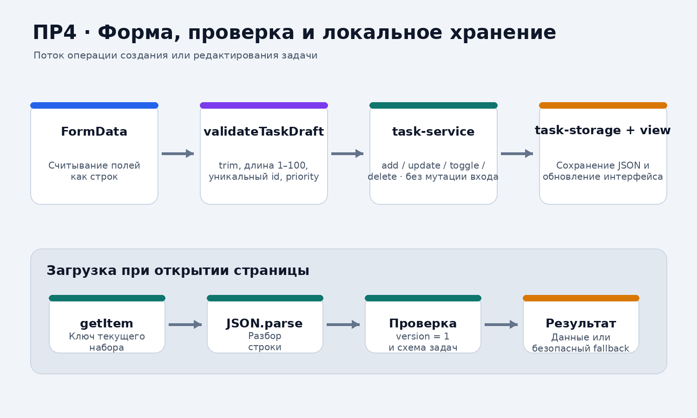
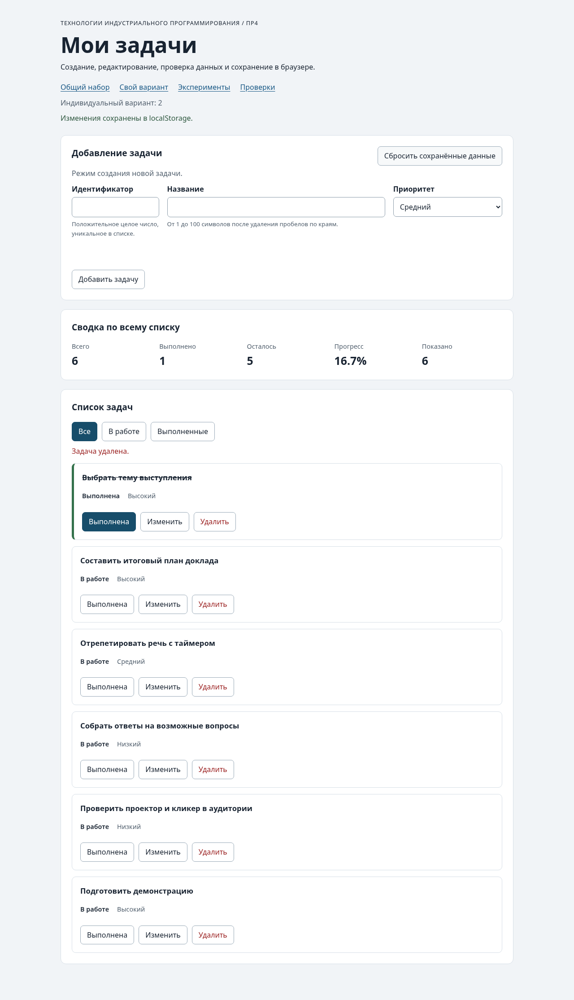

# Практическая работа № 4. Формы, валидация и локальное хранение данных

<<<<<<< HEAD
**Дисциплина:** Технологии индустриального программирования  
**Автор:** Куксов Денис Сергеевич  
**Группа:** ЭФБО-14-25  
**Вариант:** № 2 — подготовка выступления  
**Тема:** формы, прикладная проверка данных и `localStorage`

## 1. Цель и результат

Цель работы — расширить приложение списка задач из ПР3: добавить форму создания и редактирования, разделить нативную и прикладную валидацию, сохранять изменения в браузере и безопасно восстанавливать данные после перезагрузки.

В результате реализованы:

- добавление, редактирование, смена статуса и удаление задачи;
- фильтрация по статусу без изменения сохранённого набора;
- проверка `id`, названия и приоритета до изменения массива;
- версионированное хранение `{ version: 1, tasks: [...] }`;
- fallback на исходный набор при повреждённой записи, неизвестной версии или ошибке Storage;
- отдельные ключи для общего набора, индивидуального варианта и автоматических проверок;
- доступные сообщения об ошибках и возврат фокуса к элементам управления.

## 2. Запуск

Открыть терминал в папке `practice-04`.
=======
## Данные работы

| Поле | Значение |
|---|---|
| Имя | Куксов Денис Сергеевич (перенесено из отчёта ПР3) |
| Группа | ЭФБО-14-25 (перенесено из отчёта ПР3) |
| Вариант из ПР2–ПР3 | 2 — подготовка выступления |
| Node.js | v22.16.0 (среда проверки этой сборки) |
| Браузер | Браузерная проверка в этой среде не завершена; указать локальную версию после запуска |
| Операционная система | Указать фактическую ОС при локальном запуске |

Это шаблон отчёта. Формулировки «Заполнить» и ожидаемые примеры необходимо заменить фактическими результатами.

## Запуск

Рабочая папка: `practice-04` внутри личного репозитория.
>>>>>>> ad6a3d049ce480a1e96237e1aa7cd477344beef1

```bash
npm test
npm start
```

<<<<<<< HEAD
После запуска открыть:

- общий набор: `http://127.0.0.1:5504/`;
- вариант № 2: `http://127.0.0.1:5504/index.html?dataset=variant`;
- экспериментальные формы: `http://127.0.0.1:5504/examples/forms-storage.html`;
- браузерные проверки: `http://127.0.0.1:5504/checks.html`.

Пакеты не устанавливаются: работа использует встроенные средства Node.js и браузера.

## 3. Перенос из ПР3 и организация кода

Сохранена архитектура предыдущей работы. Перенесены исходный общий и индивидуальный наборы, сервис задач, селекторы и DOM-представление. В сервис добавлена `updateTask`, которая меняет название и приоритет выбранной задачи и сохраняет её `completed`.

| Файл | Назначение |
|---|---|
| `src/data.js` | Общий набор из четырёх задач и вариант № 2 из шести задач |
| `src/task-service.js` | Создание, поиск, добавление, редактирование, смена статуса и удаление; операции возвращают новый массив |
| `src/task-selectors.js` | Отбор `all`, `pending`, `completed` без мутации исходного массива |
| `src/task-view.js` | Карточки задач, сводка, пустые состояния; пользовательские строки выводятся через `textContent` |
| `src/form-validation.js` | Чистая функция `validateTaskDraft(draft, tasks, editingId)` |
| `src/task-storage.js` | Проверка схемы, загрузка, сохранение и удаление одного ключа Storage |
| `src/main.js` | Связь формы, DOM, сервиса, фильтров и Storage |

`task-storage.js` принимает объект `storage` аргументом. Это позволяет тестировать хранилище без настоящего браузерного `localStorage`, подставляя контролируемый объект с теми же методами.

## 4. Валидация формы

`validateTaskDraft` возвращает либо `{ ok: true, value }`, либо `{ ok: false, errors }`.

| Поле | Правило |
|---|---|
| `id` при создании | Положительное безопасное целое число; не должно повторяться |
| `id` при редактировании | Используется `editingId`; редактируемая задача должна существовать |
| `title` | Строка, `trim()`, длина от 1 до 100 символов |
| `priority` | Только `low`, `medium` или `high` |
| `completed` | Не берётся из формы; при редактировании сохраняется существующее значение |

HTML-атрибуты `required`, `min`, `step` и `maxlength` дают первичную нативную проверку. Прикладная функция повторяет правила и дополнительно проверяет пробелы, типы, уникальность `id` и режим редактирования. После ошибки поле получает `aria-invalid`, сообщение выводится рядом с ним, а `reportValidity()` помогает указать на ошибку.

## 5. Локальное хранилище

Для общего и индивидуального наборов используются разные ключи:

```text
tip-js-practice-04:demo
tip-js-practice-04:variant
```

Формат записи:

```json
{
  "version": 1,
  "tasks": [
    { "id": 1, "title": "Изучить функции", "completed": true, "priority": "medium" }
  ]
}
```

При загрузке строка разбирается через `JSON.parse`, затем проверяются версия, массив, обязательные поля, длина названия, типы, допустимый приоритет и уникальность идентификаторов. Если запись отсутствует, используется независимая копия исходного массива. Если JSON повреждён, версия неизвестна, схема неверна или Storage выбрасывает исключение, приложение восстанавливает исходный набор и показывает предупреждение. Сброс вызывает `removeItem` только для активного ключа; `localStorage.clear()` не используется.



## 6. Эксперименты с формой и хранилищем

| № | Сценарий | Фактическое наблюдение | Вывод |
|---:|---|---|---|
| 1 | Отправить пустую форму | Нативный `required` не пропускает форму; сервис и Storage не изменяются | Нативная проверка срабатывает до `submit` |
| 2 | Название состоит из пробелов | HTML `required` такое значение само по себе допускает, но `trim()` даёт пустую строку и прикладная проверка отклоняет её | Нужны обе проверки |
| 3 | Получить значения через `FormData` | Поля формы приходят строками; `id` преобразуется в число внутри валидатора | Нельзя предполагать, что `FormData` автоматически возвращает числа |
| 4 | Сохранить список | В Storage записывается строка JSON с `version: 1` и массивом `tasks` | Storage хранит строки, а не объекты JavaScript |
| 5 | Подложить `{broken-json` | `JSON.parse` перехватывается; стартует исходный набор и выводится предупреждение | Повреждённая запись не ломает интерфейс |

Пять сценариев отражены в модульных проверках хранения и дополнительном браузерном прогоне. Сводный протокол дополнительного прогона находится в `screenshots/browser-test-log.txt`.

## 7. Общий контрольный сценарий

Использовано начальное состояние из четырёх задач: `[1, 4, 7, 10]`. Для шага добавления введены `id = 20`, название `Изучить localStorage` и приоритет `high`; для редактирования задачи `id = 4` установлено название `Подготовить план выступления` и приоритет `low`.

| Шаг | Действие | ID после действия | Всего | Выполнено | Осталось | Прогресс | Storage |
|---:|---|---|---:|---:|---:|---:|---|
| 0 | Исходный набор | `[1,4,7,10]` | 4 | 2 | 2 | 50.0% | нет записи |
| 1 | Добавить `id=20` | `[1,4,7,10,20]` | 5 | 2 | 3 | 40.0% | сохранён |
| 2 | Попытаться добавить повторный `id=4` | `[1,4,7,10,20]` | 5 | 2 | 3 | 40.0% | без изменений |
| 3 | Отредактировать `id=4` | `[1,4,7,10,20]` | 5 | 2 | 3 | 40.0% | сохранён |
| 4 | Переключить `id=7` в выполненное | `[1,4,7,10,20]` | 5 | 3 | 2 | 60.0% | сохранён |
| 5 | Удалить `id=1` | `[4,7,10,20]` | 4 | 2 | 2 | 50.0% | сохранён |
| 6 | Повторно загрузить приложение | `[4,7,10,20]` | 4 | 2 | 2 | 50.0% | восстановлен |
| 7 | Сбросить данные | `[1,4,7,10]` | 4 | 2 | 2 | 50.0% | ключ удалён |

Фильтр `pending` в этом сценарии показывал только невыполненные задачи и не создавал отдельную запись в Storage.

## 8. Индивидуальный вариант № 2

Тема варианта — подготовка выступления. Исходный список: `[11, 23, 37, 41, 58, 64]`. По условию выполнена первая задача; остальные пять находятся в работе.

| Этап | ID | Всего | Выполнено | Осталось | Прогресс |
|---|---|---:|---:|---:|---:|
| Исходный набор | `[11,23,37,41,58,64]` | 6 | 1 | 5 | 16.7% |
| Добавлена задача `75` «Подготовить демонстрацию» | `[11,23,37,41,58,64,75]` | 7 | 1 | 6 | 14.3% |
| `id=23` изменена на «Составить итоговый план доклада» | `[11,23,37,41,58,64,75]` | 7 | 1 | 6 | 14.3% |
| Удалена `id=37` | `[11,23,41,58,64,75]` | 6 | 1 | 5 | 16.7% |
| Повторная загрузка | `[11,23,41,58,64,75]` | 6 | 1 | 5 | 16.7% |
| Сброс | `[11,23,37,41,58,64]` | 6 | 1 | 5 | 16.7% |



## 9. Результаты автоматических и браузерных проверок

Команда `npm test` запускает оба набора:

```text
Проверки сервиса: 35 успешно, 0 ошибок.
Проверки новых модулей: 27 успешно, 0 ошибок.
Всего: 62/62.
```

Дополнительно выполнен сценарный прогон UI в Chromium 144.0.7559.96: 19 сценариев, 19 успешно, 0 ошибок. Проверены общий набор, нативная проверка формы, дубликат, пробельное название, создание, версия JSON, редактирование, переключение, удаление, фильтр, восстановление, сброс и вариант № 2.

**Ограничение среды:** браузерный прогон выполнялся на изолированной странице Chromium с совместимой тестовой реализацией `localStorage`; штатная страница `checks.html` включена в проект для запуска в обычном браузере через `npm start`. Это ограничение указано, чтобы не выдавать тестовый объект Storage за ручную проверку реального профиля браузера. Реальные функции Storage дополнительно проверены отдельными модульными тестами 27/27.

Полный вывод Node.js-проверок: [`results/test-results.txt`](./results/test-results.txt).  
Протокол UI-сценариев: [`results/browser-visual-test.txt`](./results/browser-visual-test.txt).

## 10. Отладка и доступность

Основная точка останова — `handleFormSubmit` в `src/main.js`:

1. `FormData` содержит исходные строковые значения `id`, `title`, `priority`.
2. `validateTaskDraft` возвращает нормализованный объект или карту ошибок.
3. `addTask` / `updateTask` создают новый массив; исходный список не меняется.
4. `saveTasks` сериализует текущий набор в JSON-конверт версии 1.
5. `renderApp` повторно строит карточки, статистику и пустое состояние.

Клавиатурные действия основаны на стандартных `input`, `select` и `button`. Кнопки карточек имеют `type="button"`. При начале редактирования фокус переводится на название, при сохранении — на поле идентификатора, после toggle/delete — на соответствующее действие либо на активный фильтр. Сообщения размещены в `aria-live`-областях.

## 11. Иллюстрации

- [Рабочий интерфейс общего набора](./screenshots/pr04-app.png) — начальное состояние.
- [Рабочий интерфейс после добавления задачи](./screenshots/pr04-after-add.png).
- [Поток валидации и Storage](./screenshots/workflow-storage.png) — архитектурная схема, не скриншот браузера.

## 12. Вывод

В ПР4 расширено приложение из ПР3 без переписывания сервисного слоя. Нативная проверка HTML даёт первичную обратную связь, прикладная валидация проверяет бизнес-правила и нормализует данные, а `task-storage.js` проверяет схему после чтения JSON. Все 62 автоматические проверки и 19 дополнительных UI-сценариев завершились успешно. Для финальной сдачи остаётся при необходимости открыть встроенный `checks.html` в браузере на своей машине и приложить снимок из собственного профиля браузера.
=======
Устанавливать зависимости через `npm install` не требуется.

```text
http://127.0.0.1:5504/
http://127.0.0.1:5504/index.html?dataset=variant
http://127.0.0.1:5504/examples/forms-storage.html
http://127.0.0.1:5504/checks.html
```

Если использован другой порт, указать фактическую команду и адрес.

## Перенос результата ПР3

Указать, какие модули перенесены из ПР3, какие исправления потребовались и какой результат показали повторные проверки сервиса.

| Файл | Что перенесено или изменено |
|---|---|
| `data.js` | Перенесены общий набор и вариант 2 из ПР3 без изменения шести задач |
| `task-service.js` | Перенесён сервис ПР3; добавлена `updateTask`, сохраняющая `completed` |
| `task-selectors.js` | Перенесён фильтр all/pending/completed из ПР3 |
| `task-view.js` | Перенесена отрисовка ПР3; добавлена кнопка «Изменить» |

## Эксперименты с формой и хранилищем

| № | До запуска: прогноз | После запуска: результат | Объяснение |
|---:|---|---|---|
| 1. Пустое обязательное поле | Заполнить | Заполнить | Заполнить |
| 2. Название из пробелов | Заполнить | Заполнить | Заполнить |
| 3. Типы значений `FormData` | Заполнить | Заполнить | Заполнить |
| 4. Строка в `localStorage` и JSON | Заполнить | Заполнить | Заполнить |
| 5. Повреждённый JSON | Заполнить | Заполнить | Заполнить |

## Организация кода

Кратко описать ответственность `task-service.js`, `form-validation.js`, `task-storage.js`, `task-view.js` и `main.js`. Объяснить, почему функции хранения получают объект `storage` аргументом и почему данные из JSON проверяются до использования.

## Проверка формы

| Сценарий | Ожидаемый результат | Фактический результат | Итог |
|---|---|---|---|
| Добавление корректной задачи | Заполнить | Заполнить | Заполнить |
| Повторяющийся id | Отказ без изменения списка | Заполнить | Заполнить |
| Пустое название | Отказ | Заполнить | Заполнить |
| Название из пробелов | Отказ прикладной проверки | Заполнить | Заполнить |
| Название длиной 100 | Успех | Заполнить | Заполнить |
| Название длиной 101 | Отказ | Заполнить | Заполнить |
| Редактирование title и priority | Меняется одна задача, статус сохраняется | Заполнить | Заполнить |
| Отмена редактирования | Возврат к пустой форме создания | Заполнить | Заполнить |

## Общий сценарий

Записать фактические результаты последовательности из раздела 6.8 методички.

| Шаг | Действие | Видимые id | Всего | Выполнено | Осталось | Прогресс | Состояние storage |
|---:|---|---|---:|---:|---:|---:|---|
| 0 | Исходный запуск после сброса | Заполнить | | | | | |
| 1 | Добавление `id = 20` | Заполнить | | | | | |
| 2 | Отказ для повторного `id = 4` | Заполнить | | | | | |
| 3 | Редактирование `id = 4` | Заполнить | | | | | |
| 4 | Переключение `id = 7` | Заполнить | | | | | |
| 5 | Удаление `id = 1` | Заполнить | | | | | |
| 6 | Перезагрузка страницы | Заполнить | | | | | |
| 7 | Сброс данных | Заполнить | | | | | |

## Проверка восстановления и ошибок

| Случай | Ожидание | Фактический результат | Итог |
|---|---|---|---|
| Записи нет | Используется независимая копия исходного набора | Заполнить | Заполнить |
| Корректная запись | Данные восстанавливаются после перезагрузки | Заполнить | Заполнить |
| Повреждённый JSON | Приложение запускается с исходным набором и предупреждением | Заполнить | Заполнить |
| Неверная версия или схема | Исходный набор и предупреждение | Заполнить | Заполнить |
| Сброс | Удаляется только ключ текущего набора | Заполнить | Заполнить |
| Общий и индивидуальный наборы | Изменения не смешиваются | Заполнить | Заполнить |

## Индивидуальный вариант

Указать исходные шесть задач. После сброса добавить задачу `id = 75`, отредактировать `id = 23`, удалить `id = 37`, перезагрузить страницу и проверить восстановление результата.

| Этап | Всего | Выполнено | Осталось | Прогресс | Видимые id |
|---|---:|---:|---:|---:|---|
| Исходный набор | Заполнить | | | | |
| После добавления `75` | Заполнить | | | | |
| После редактирования `23` | Заполнить | | | | |
| После удаления `37` | Заполнить | | | | |
| После перезагрузки | Заполнить | | | | |
| После сброса | Заполнить | | | | |

## Протокол проверок сервиса

Вставить реальный вывод `npm run check:service`.

```text
Здесь будет фактический вывод.
```

## Протокол проверок новых модулей

Вставить реальный вывод `npm run check:modules`.

```text
Здесь будет фактический вывод.
```

## Протокол браузерных проверок

Вставить реальный текст из блока «Текстовый протокол» на `checks.html`.

```text
Здесь будет фактический вывод.
```

## Собственные проверки

| № | Исходное состояние и действия | Ожидаемый результат | Фактический результат | Итог |
|---:|---|---|---|---|
| 1 | Заполнить | Заполнить | Заполнить | Заполнить |
| 2 | Заполнить | Заполнить | Заполнить | Заполнить |
| 3 | Заполнить | Заполнить | Заполнить | Заполнить |

Минимум один случай относится к границе формы, один — к восстановлению после перезагрузки, один — к повреждённым или недоступным данным хранилища.

## Отладка и клавиатура

Указать точку останова в `handleFormSubmit`, значения сырого `draft`, результата `validateTaskDraft`, результата сервисной операции и строки JSON. Описать проверку формы и действий карточек с помощью Tab, Enter и Space, а также положение фокуса при начале и отмене редактирования.

## Вид приложения

Добавить изображение или ссылку на демонстрацию, полученную после собственного запуска. Изображение ожидаемого результата не заменяет фактическую проверку.

## Дополнительное задание

Не выполнено / указать выбранное расширение, его правила и минимум три проверки.

## Вывод

Кратко описать результат, исправленные ошибки и различие между нативной проверкой HTML, прикладной валидацией и проверкой данных после чтения из хранилища.

## Текущий статус подготовки

В среде сборки успешно выполнены `npm run check:service` (35/35) и
`npm run check:modules` (27/27). Автоматическая браузерная проверка и ручные
сценарии интерфейса не подтверждены: попытка запуска headless Chromium в
среде сборки завершилась ошибкой запуска браузера. Поэтому таблицы браузерных
сценариев, экспериментов, индивидуального варианта, клавиатурного тестирования
и собственных проверок необходимо заполнить по фактическому локальному запуску;
они не отмечены как пройденные заранее.
>>>>>>> ad6a3d049ce480a1e96237e1aa7cd477344beef1
