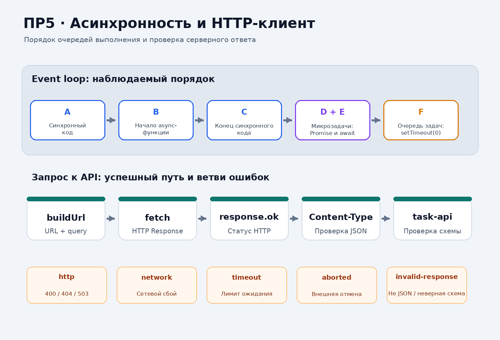
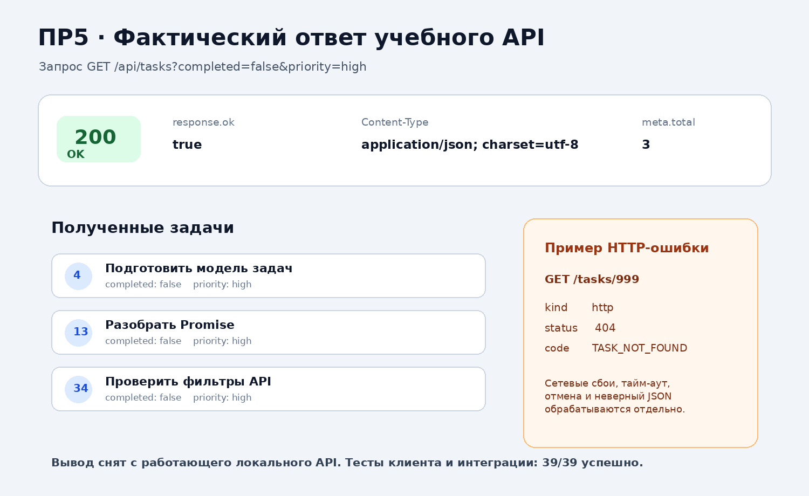
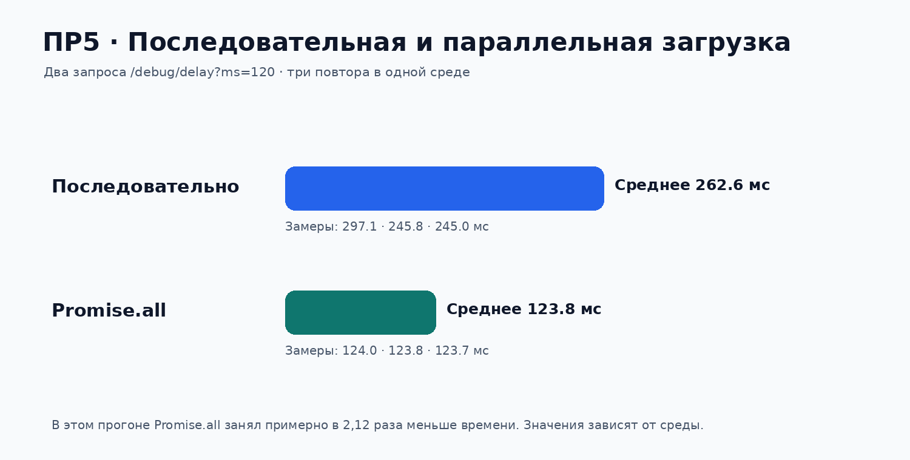

# Практическая работа № 5. Асинхронные операции и получение данных с сервера

**Дисциплина:** Технологии индустриального программирования  
**Автор:** Куксов Денис Сергеевич  
**Группа:** ЭФБО-14-25  
**Вариант:** № 2  
**Тема:** Promise, `async`/`await`, Fetch API и общий HTTP-клиент

## Проверочное окружение

Node.js v22.16.0, npm 10.9.2, Linux x86_64. Команды запуска подходят для Windows, macOS и Linux.

## 1. Цель и результат

Цель работы — реализовать отдельный от предметной области HTTP-клиент, научиться проверять ответ `fetch`, обрабатывать асинхронные ошибки, ограничивать время ожидания и загружать независимые данные параллельно.

В ПР5 есть работающая браузерная панель чтения данных из учебного REST API. Она использует тот же HTTP-клиент и предметный модуль, что и консольные примеры. Из интерфейса доступны фильтрация, получение одной задачи и демонстрация HTTP 404.

## 2. Запуск

Из папки `practice-05` выполните:

```bash
npm start
```

Команда запускает API и сайт. Откройте `http://127.0.0.1:5507/`; вариант № 2 доступен по адресу `http://127.0.0.1:5507/?dataset=variant`. API слушает `http://127.0.0.1:5505/api`. Доступность сайта и API проверена; протокол сохранён в `results/web-smoke-test.txt`. После запуска во втором терминале можно выполнить дополнительные консольные эксперименты:

```bash
npm run example:order
npm run example:fetch
npm run client
npm test
```

Если порт 5505 занят другим экземпляром учебного API, запустить сервер на свободном порту. Например, в Git Bash:

```bash
API_PORT=5508 WEB_PORT=5507 npm start
API_URL=http://127.0.0.1:5508/api npm run example:fetch
API_URL=http://127.0.0.1:5508/api npm run client
```

В PowerShell переменные задаются как `$env:API_PORT = "5508"`, `$env:WEB_PORT = "5507"` и `$env:API_URL = "http://127.0.0.1:5508/api"`. Для браузера при таком запуске откройте `http://127.0.0.1:5507/?api=http://127.0.0.1:5508/api`.

## 3. Структура и ответственность модулей

| Файл | Ответственность |
|---|---|
| `api/server.mjs` | Готовый учебный API: маршруты, фильтры, ошибки и отладочные endpoints |
| `api/data.js` | 12 задач и 3 категории учебного набора |
| `src/api-client.js` | `ApiError`, `buildUrl`, `requestJson`, тайм-аут и внешний `AbortSignal` |
| `src/task-api.js` | Фильтры предметной области, проверка схемы задач/категорий, `getTasks`, `getTaskById`, `getCategories`, `loadInitialData` |
| `src/variant.js` | Номер и фильтры индивидуального варианта |
| `src/main.js` | Консольный сценарий, вывод таблицы, замер последовательной и параллельной загрузки |
| `src/browser-main.js` | Браузерная панель: фильтры, список задач, карточка отдельной задачи и HTTP-ошибки |
| `index.html`, `styles.css` | Интерфейс для показа работы в браузере |
| `tools/start.mjs`, `tools/static-server.mjs` | Совместный запуск API и сайта |
| `examples/event-loop.html` | Интерактивная демонстрация порядка event loop в браузере |
| `examples/event-loop.js` | Демонстрация очередей синхронного кода, микрозадач и таймеров |
| `examples/fetch-basics.js` | Прямой пример HTTP-запроса и чтения JSON |

## 4. Эксперимент с очередями выполнения

До запуска прогнозировался такой порядок: сначала синхронные метки `A`, `B`, `C`; затем микрозадачи `D`, `E`; после освобождения стека и очереди микрозадач — таймер `F`.

Команда `npm run example:order` вывела:

```text
A: синхронный код
B: начало async-функции
C: конец синхронного кода
D: обработчик Promise
E: продолжение после await
F: задача таймера
```

| Метка | Очередь / этап | Объяснение |
|---|---|---|
| A | Синхронный стек | Выполняется немедленно при входе в сценарий |
| B | Синхронный стек | `async`-функция начинает выполняться синхронно до первого `await` |
| C | Синхронный стек | Завершается текущий синхронный код |
| D | Очередь микрозадач | Обработчик Promise выполняется после освобождения стека |
| E | Очередь микрозадач | Продолжение после `await` также планируется как микрозадача |
| F | Очередь задач таймеров | `setTimeout(..., 0)` не прерывает текущий стек и очередь микрозадач |

Если убрать обработчик Promise, метка D не появляется; остальные сообщения сохраняют причинный порядок. Нулевая задержка таймера означает минимальную задержку планирования, а не немедленное выполнение. Добавленный экспериментальный обработчик `Promise.resolve().then(...)` ставится в очередь микрозадач в месте регистрации; его вывод появляется после текущего синхронного стека и до таймера.



Интерактивный пример доступен по адресу `http://127.0.0.1:5507/examples/event-loop.html`.

## 5. Наблюдение за HTTP-ответом

Пример `npm run example:fetch` был выполнен с работающим локальным учебным API. Фактический результат:

| Свойство | Значение |
|---|---|
| URL | `http://127.0.0.1:5507/api/tasks?completed=false&priority=high` |
| Метод | `GET` |
| Статус | `200` |
| `response.ok` | `true` |
| `Content-Type` | `application/json; charset=utf-8` |
| Полученные ID | `[4, 13, 34]` |
| `meta.total` | `3` |
| `meta.filters` | `{ completed: false, priority: "high", categoryId: null, q: "" }` |

Порт 5507 использован в этом протоколе потому, что на стандартном порту 5505 одновременно работал сервер ПР6. При обычном отдельном запуске ПР5 используется порт 5505.



Дополнительно проверены обязательные маршруты через отдельный HTTP-клиент `curl`: `/health` вернул `200` и `{ "data": { "status": "ok" } }`; `/tasks/25` вернул задачу `id=25`; `/tasks/999` вернул `404` с кодом `TASK_NOT_FOUND` и `details.id=999`. Полные HTTP-заголовки и тела ответа сохранены в [`results/api-inspection.txt`](./results/api-inspection.txt).

## 6. Реализация общего HTTP-клиента

`buildUrl(baseUrl, path, query)` объединяет адрес и путь без двойного слеша и формирует query через `URLSearchParams`. Значения `false` и `0` сохраняются, `null`, `undefined` и пустые строки пропускаются. Исходный объект query не изменяется.

`createApiClient({ baseUrl, fetchFn, timeoutMs })` возвращает `requestJson`. Функция:

1. проверяет абсолютный HTTP(S) URL и конфигурацию клиента;
2. создаёт запрос `GET` с `Accept: application/json`;
3. объединяет внешний `AbortSignal` с внутренним контроллером тайм-аута;
4. отдельно преобразует HTTP-ошибки и сетевые отклонения;
5. проверяет, что получен объект, похожий на `Response`;
6. у успешного ответа проверяет `Content-Type`, читает текст и разбирает JSON;
7. проверяет предметную схему в `task-api.js`.

`fetchFn` внедряется аргументом: в модульных проверках вместо реальной сети можно вернуть заранее подготовленный `Response` или отклонить Promise. Это обеспечивает детерминированные проверки без обращения к серверу.

HTTP-ошибка проверяется до успешного `Content-Type`: у ответа 404/503 тело может быть текстовым или повреждённым, но основной факт — сервер вернул HTTP-ошибку — должен сохраниться.

## 7. Классификация ошибок

С фактического локального API получены следующие результаты:

| Сценарий | `kind` | Статус | Код / детали |
|---|---|---:|---|
| `GET /tasks/999` | `http` | 404 | `TASK_NOT_FOUND`, `{ id: 999 }` |
| `GET /tasks?completed=yes` | `http` | 400 | `INVALID_QUERY` |
| `GET /debug/error` | `http` | 503 | `SERVICE_UNAVAILABLE` |
| `GET /debug/invalid-json` | `invalid-response` | 200 | Повреждённый JSON |
| `GET /debug/text` | `invalid-response` | 200 | Успешный ответ не JSON |
| API остановлен / порт недоступен | `network` | — | Ответ не получен |
| Задержка 150 мс при `timeoutMs=30` | `timeout` | — | Истёк внутренний таймер |
| Внешний `AbortController.abort()` | `aborted` | — | Запрос отменён вызывающим кодом |

Пример объекта ошибки для отсутствующей задачи:

```js
{
  name: "ApiError",
  kind: "http",
  status: 404,
  code: "TASK_NOT_FOUND",
  details: { id: 999 },
  url: "http://127.0.0.1:5507/api/tasks/999"
}
```

У тайм-аута, внешней отмены и сетевой ошибки нет HTTP-статуса, потому что корректный HTTP-ответ в этих случаях не получен.

## 8. Доменный модуль задач

В исходном учебном наборе 12 задач и 3 категории: `Учёба` (`id=1`), `Проект` (`id=2`) и `Организация` (`id=3`). Поддерживаются `getTasks(filters)`, `getTaskById(id)`, `getCategories()` и `loadInitialData(filters)`.

| Вызов | Фактический результат |
|---|---|
| `getTasks()` | 12 задач; ID `[1,4,7,10,13,16,19,22,25,28,31,34]` |
| `getTasks({ completed: false, priority: "high" })` | ID `[4,13,34]`, `meta.total = 3` |
| `getTaskById(25)` | `{ id: 25, title: "Исправить обработку ошибок", completed: true, priority: "high", categoryId: 2 }` |
| `getCategories()` | `[ { id:1, name:"Учёба" }, { id:2, name:"Проект" }, { id:3, name:"Организация" } ]` |
| `loadInitialData()` | Параллельно возвращает 12 задач, 3 категории и метаданные списка |

Проверяются допустимые имена и типы фильтров, положительный целый `id`, обязательные поля задачи и категории, допустимые статусы и приоритеты, уникальность ID и согласованность `meta.total` с длиной массива. Корректный JSON сам по себе не гарантирует корректную предметную запись.

## 9. Последовательная и параллельная загрузка

Выполнено по три серии из двух независимых запросов `GET /api/debug/delay?ms=120`. Получены следующие измерения:

| Сценарий | Запуск 1 | Запуск 2 | Запуск 3 | Среднее |
|---|---:|---:|---:|---:|
| Последовательные `await` | 297.1 мс | 245.8 мс | 245.0 мс | 262.6 мс |
| `Promise.all` | 124.0 мс | 123.8 мс | 123.7 мс | 123.8 мс |



Первый последовательный замер содержит большую дополнительную задержку прогрева окружения. В этой серии среднее время с `Promise.all` оказалось примерно в 2.12 раза меньше. Это наблюдение относится к указанной среде и не является универсальной гарантией ускорения для любых запросов.

## 10. Индивидуальный вариант № 2

В `src/variant.js` задано `variantNumber = 2`, `variantFilters = { completed: true }`. Запуск `npm run client` получил пять выполненных задач:

```text
[1, 10, 16, 25, 31]
meta.total = 5
```

В выводе консоли также показана карточка задачи для каждого элемента, время загрузки и демонстрационная ошибка 404 для `id=999`.

## 11. Собственные проверки и отладка

| № | Сценарий | Фактический результат |
|---:|---|---|
| 1 | URL с query, содержащим `false`, `0`, пробелы, кириллицу и `&` | Значения корректно кодируются; логические `false` и число `0` не теряются |
| 2 | Запрос отсутствующей задачи `999` | `ApiError`, `kind=http`, статус 404, `TASK_NOT_FOUND`, details `{id:999}` |
| 3 | Повреждённый JSON, неверный Content-Type, тайм-аут и внешняя отмена | Получены отдельные `invalid-response`, `timeout` и `aborted` |

Точки останова для отладки: до `fetchFn(url, options)`, сразу после получения `Response`, перед чтением JSON и в `catch`. Для успешного ответа контролируются URL, статус 200, `ok=true`, Content-Type и payload; для 404 — статус, `code`, `details` и URL.

Полные выводы команд находятся в `results/`:

- [`example-order.txt`](./results/example-order.txt);
- [`example-fetch.txt`](./results/example-fetch.txt);
- [`variant-2.txt`](./results/variant-2.txt);
- [`timing-measurements.txt`](./results/timing-measurements.txt);
- [`api-inspection.txt`](./results/api-inspection.txt) — фактические ответы `/health`, `/tasks/25`, `/tasks/999`;
- [`test-results.txt`](./results/test-results.txt).

## 12. Результаты автоматических проверок

`npm test` выполнил три набора:

| Набор | Успешно | Ошибок |
|---|---:|---:|
| API server | 18 | 0 |
| API client + task API | 26 | 0 |
| Интеграция с реальным локальным API | 13 | 0 |
| **Итого** | **57** | **0** |

Интеграционный набор проверяет настоящие HTTP-запросы: фильтрацию, получение задачи и категорий, параллельную загрузку, 400/404/503, повреждённый JSON и отмену/тайм-аут.

## 13. Дополнительное задание

Опциональное расширение (частичный результат через `Promise.allSettled` либо ограниченный повтор GET) не включалось. Обязательные функции общего и предметного клиента, тайм-аут, внешняя отмена, параллельная загрузка, индивидуальный вариант и три собственных сценария реализованы и покрыты указанными проверками.

## 14. Вывод

Создан переиспользуемый JSON-клиент и независимый от сети доменный модуль задач. HTTP-ошибка означает, что сервер ответил статусом ошибки; `network` — что ответ не был получен; `invalid-response` — что формат или схема ответа не соответствуют контракту; `timeout` — что ожидание превысило заданный лимит; `aborted` — что запрос отменён явно. Независимые начальные запросы запускаются параллельно через `Promise.all`. Все 57 автоматических проверок пройдены.
