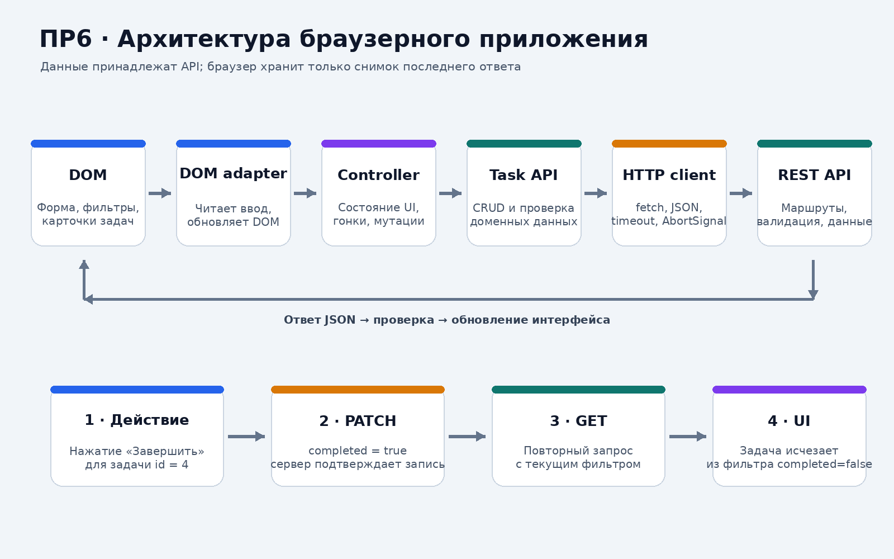
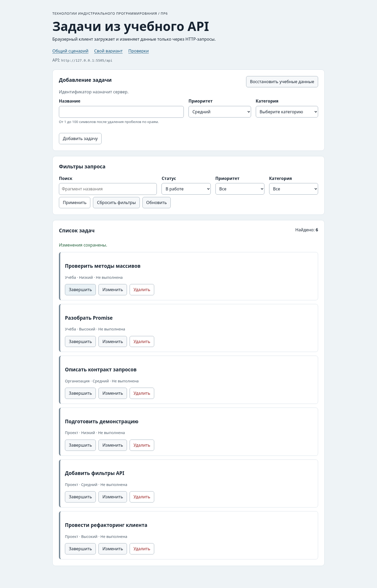

# Практическая работа № 6. Подключение браузерного приложения к API

**Дисциплина:** Технологии индустриального программирования  
**Автор:** Куксов Денис Сергеевич  
**Группа:** ЭФБО-14-25  
**Вариант:** № 2  
**Тема:** браузерный клиент, CRUD через HTTP и управление асинхронным состоянием

## 1. Цель и результат

Цель работы — подключить браузерное приложение списка задач к учебному HTTP API и разделить UI, контроллер, предметные операции и транспортный слой.

Реализованы:

- загрузка задач и категорий с сервера;
- фильтрация по названию, статусу, приоритету и категории;
- создание (`POST`), редактирование и смена статуса (`PATCH`), удаление (`DELETE`);
- повторная загрузка списка после каждой успешной мутации;
- состояния `loading`, `ready`, `empty`, `error` и кнопка повтора;
- клиентская валидация формы по фактическому списку категорий;
- блокировка повторных действий на время мутации;
- отмена старых запросов и защита от устаревших ответов;
- доступные статусные сообщения и безопасный вывод пользовательского текста.

Данные не записываются в `localStorage`: источником истины является сервер, браузер хранит только состояние последнего ответа в памяти.

## 2. Запуск

Из папки `practice-06` выполнить:

```bash
npm start
```

Команда запускает два локальных сервера:

- приложение: `http://127.0.0.1:5506/`;
- API: `http://127.0.0.1:5505/api`;
- браузерные проверки: `http://127.0.0.1:5506/checks.html`.

Индивидуальный вариант № 2: `http://127.0.0.1:5506/?dataset=variant`.

Остановка обоих серверов — `Ctrl+C`. Для проверки Node.js-модулей и API:

```bash
npm test
```

ПР5 и ПР6 по умолчанию используют один и тот же порт API 5505. Не нужно одновременно запускать два API-сервера на одном порту. При отдельном запуске каждой практики конфликтов нет.

## 3. Архитектура

| Файл | Ответственность |
|---|---|
| `src/main.js` | Точка входа: чтение URL/варианта, создание зависимостей, соединение обработчиков |
| `src/dom-app.js` | DOM-адаптер: чтение полей, события, обновление элементов интерфейса |
| `src/app-controller.js` | Состояние приложения, фильтры, редактирование, мутации, повторная загрузка и защита от гонок |
| `src/task-api.js` | Доменные методы задач и проверка формы ответов API |
| `src/api-client.js` | `buildUrl`, методы HTTP, JSON, `ApiError`, timeout и abort |
| `src/form-validation.js` | Проверка названия, приоритета и ID существующей категории |
| `src/task-view.js` | Безопасное построение карточек через DOM API и `textContent` |
| `api/server.mjs` | Учебный REST API: GET/POST/PATCH/DELETE, валидация и сброс данных |
| `tools/start.mjs` | Совместный запуск API и статического сервера приложения |



## 4. HTTP-клиент и предметный API

В ПР5 клиент поддерживал чтение; в ПР6 `requestJson` расширен методами `GET`, `POST`, `PATCH`, `DELETE`.

| Требование | Реализация |
|---|---|
| Методы | Разрешён только `GET`, `POST`, `PATCH`, `DELETE` |
| `GET` с телом | Отклоняется до сетевого запроса |
| `Accept` | Каждый запрос принимает `application/json` |
| `Content-Type` | Добавляется только при наличии JSON body |
| Тело | Объект сериализуется через `JSON.stringify` |
| Ответ 204 | Возвращается `null`, `response.json()` не вызывается |
| HTTP-ошибки | `ApiError` сохраняет `status`, `code`, `details`, `url` |
| Остальные ошибки | Различаются `network`, `invalid-response`, `timeout`, `aborted` |

`task-api.js` предоставляет `getTasks`, `getTaskById`, `getCategories`, `loadInitialData`, `createTask`, `updateTask`, `setTaskCompleted`, `deleteTask`, `resetDemoData`. Перед передачей данных UI проверяются поля задачи/категории, уникальность ID и метаданные. `loadInitialData` загружает задачи и категории с помощью `Promise.all`.

## 5. Валидация формы

`validateTaskDraft(draft, categories)` — чистая функция, не обращается к DOM и не меняет входные объекты.

| Поле | Проверка |
|---|---|
| `title` | Строка после `trim`, длина от 1 до 100 символов |
| `priority` | Одно из `low`, `medium`, `high` |
| `categoryId` | Положительное целое число, присутствующее в загруженном списке категорий |

При ошибке возвращается `{ valid: false, value: null, errors }`. При успехе — нормализованный `value`, готовый для POST/PATCH. Сервер повторяет проверку, потому что клиентскую валидацию можно обойти.

## 6. Состояния интерфейса

| Состояние | Условие | Что видит пользователь |
|---|---|---|
| `loading` | Ожидается ответ API | Текст загрузки, `aria-busy=true` |
| `ready` | Запрос успешен, список непустой | Карточки, счётчик найденных задач |
| `empty` | Запрос успешен, но список пуст | Сообщение «По выбранным условиям задач нет» |
| `error` | Ошибка HTTP, сети или формата ответа | Понятная причина и кнопка «Повторить загрузку» |

`empty` — не ошибка. При ошибке старые карточки не выдаются за результат нового запроса. Ошибки преобразуются через `messageForError`, чтобы пользователю не показывались внутренние stack trace.

## 7. CRUD и источник истины

| Действие интерфейса | Запрос | Поведение после ответа |
|---|---|---|
| Добавить задачу | `POST /api/tasks` | Сервер назначает ID, затем выполняется GET текущего фильтра |
| Сохранить редактирование | `PATCH /api/tasks/:id` | Список загружается повторно |
| Завершить / вернуть в работу | `PATCH /api/tasks/:id` с `completed` | Список загружается повторно; задача может исчезнуть из фильтра |
| Удалить | `DELETE /api/tasks/:id` | Ожидается `204`, затем GET |
| Восстановить учебные данные | `POST /api/debug/reset` | Сервер сбрасывает данные, затем GET |

Повторный GET нужен потому, что именно сервер назначает ID, применяет ограничения и возвращает актуальное состояние. Оптимистическое локальное изменение не подменяет подтверждённый ответ.

## 8. Защита от гонок запросов

При смене фильтра контроллер отменяет предшествующий запрос через `AbortController`. Дополнительно у каждого запроса есть возрастающий `requestVersion`. Результат применяется только при совпадении его версии с последней. Это защищает UI даже в случае API-двойника или кэша, который не завершает старую операцию сразу после отмены.

Изменяющая операция блокирует связанные кнопки до завершения. После успешного POST/PATCH/DELETE запускается повторная загрузка с текущими фильтрами. Отмена из-за смены фильтра не считается ошибкой и не показывает красное сообщение.

## 9. Индивидуальный вариант № 2

Для варианта № 2 `src/variant.js` задаёт `completed: true`. Индивидуальная страница получает от сервера только выполненные задачи:

```text
ID: [1, 10, 16, 25, 31]
Всего найдено: 5
```

Сценарий по варианту: открыть индивидуальную страницу, выбрать выполненную карточку, нажать «Вернуть в работу». Сервер получает PATCH с `completed: false`; контроллер повторно запрашивает тот же фильтр `completed=true`, поэтому изменённая задача больше не входит в результат.

Отдельно выполнен HTTP-сценарий варианта № 2 с реальным API: после сброса GET с `completed=true` вернул `[1,10,16,25,31]`; PATCH задачи `id=1` с `completed:false` вернул `200`; повторный GET с тем же фильтром вернул `[10,16,25,31]`, а GET `/tasks/1` подтвердил `completed=false`. Протокол: [`results/variant-2-api-scenario.txt`](./results/variant-2-api-scenario.txt). Это проверка реального серверного API; она не подменяет браузерный сценарий.

## 10. Контрольный сценарий браузерного интерфейса

Проверен сценарий из формы задания: применить `completed=false`, затем переключить задачу `id=4` в выполненное состояние.

| Шаг | Действие | ID в отфильтрованном списке |
|---:|---|---|
| 1 | Начальная загрузка всех задач | `[1,4,7,10,13,16,19,22,25,28,31,34]` |
| 2 | Фильтр `completed=false` | `[4,7,13,19,22,28,34]` |
| 3 | Нажать «Завершить» у `id=4` | PATCH `completed=true` |
| 4 | Повторный GET с `completed=false` | `[7,13,19,22,28,34]` |



На изображении отображён интерфейс после изменения статуса: задача `id=4` уже отсутствует в выборке `completed=false`, а сообщение подтверждает успешное сохранение.

## 11. Результаты автоматических проверок

Фактически выполнено `npm test`:

| Набор | Успешно | Ошибок |
|---|---:|---:|
| API server | 23 | 0 |
| Модули (HTTP-клиент, task API, валидация, контроллер) | 33 | 0 |
| Интеграция с реальным API | 14 | 0 |
| **Итого** | **70** | **0** |

Интеграционные проверки работают с HTTP-сервером, а не только с заглушкой: создание задачи с серверным ID, чтение, редактирование, поиск, смена статуса, удаление и `204`, серверная ошибка валидации, тайм-аут, отмена, повреждённый JSON и reset.

### Дополнительный визуальный прогон

UI и CSS приложения были загружены в Chromium 144.0.7559.96 и отрисованы в настоящем DOM. Для изолированного визуального сценария `fetch` был заменён тестовым адаптером с начальным набором данных, полученным от локального API; браузерный сетевой запрос в этом окружении не использовался. Проверены начальная загрузка, фильтр `completed=false`, PATCH `id=4` и повторная фильтрация. Это визуальная проверка логики интерфейса, а не скриншот вкладки Network.

Реальные серверные HTTP-операции покрыты интеграционным набором 14/14. Полный протокол визуального прогона: [`results/browser-visual-test.txt`](./results/browser-visual-test.txt).

Полный Node.js-журнал: [`results/test-results.txt`](./results/test-results.txt).

### Штатные браузерные проверки

В проект включён `checks.html` и набор из 14 браузерных сценариев (`checks/browser.checks.js`): запуск приложения, серверная фильтрация, `empty`, создание, валидация, редактирование, отмена редактирования, смена статуса, удаление, reset, недоступный API и отсутствие зависимости от `localStorage`. Для запуска на своём компьютере выполните `npm start`, затем откройте `http://127.0.0.1:5506/checks.html`. В среде сборки архива Chromium блокировал переход к локальному адресу с `ERR_BLOCKED_BY_ADMINISTRATOR`, поэтому итог этих 14 браузерных сценариев здесь не помечен как пройденный. Их код, как и сами страницы приложения, включён в ZIP; 70 Node.js-проверок и 14 реальных HTTP-интеграционных проверок выполнены успешно.

## 12. Ответы на контрольные вопросы

1. **Почему `fetch` не считает HTTP 404 сетевой ошибкой?** Promise `fetch` разрешается, потому что HTTP-ответ получен. Приложение самостоятельно проверяет `response.ok` и преобразует статус ошибки в `ApiError(kind="http")`.
2. **Почему нельзя вызывать `response.json()` для 204?** Статус 204 означает отсутствие тела. Разбор пустой строки как JSON завершился бы ошибкой, поэтому клиент возвращает `null`.
3. **Чем отличаются `empty` и `error`?** `empty` — корректный ответ API с пустым массивом; `error` — получить корректный результат не удалось.
4. **Зачем отменять предыдущий запрос?** Чтобы не тратить ресурсы на ненужный фильтр. Счётчик версии дополнительно предотвращает перезапись более нового состояния старым ответом.
5. **Зачем после мутации повторно получать список?** Сервер — источник истины: он подтверждает изменение, назначает идентификатор и применяет активные фильтры. UI показывает уже подтверждённые данные.

## 13. Доступность и безопасный вывод

Список получает `aria-busy`, состояния и сообщения используют `role="status"` и `aria-live="polite"`. Название задачи выводится через `textContent`, а не `innerHTML`, поэтому пользовательская строка не интерпретируется как HTML. Кнопки действий имеют `type="button"`; удаление и сброс требуют подтверждения.

## 14. Иллюстрации

- [Начальный интерфейс приложения](./illustrations/pr06-app.png).
- [Состояние после фильтра и изменения `id=4`](./illustrations/pr06-filter-toggle.png).
- [Архитектура и цикл мутации](./illustrations/architecture-mutation-flow.png) — схема, не скриншот.

## 15. Дополнительное задание

Опциональные расширения из методички (сортировка, debounce, ограниченный повтор и другие) не включались. Обязательная реализация CRUD, фильтрации через API, обработки ошибок, отмены устаревших запросов, варианта № 2 и все 70 Node.js-проверок выполнены.

## 16. Вывод

Браузерное приложение разделено на DOM-адаптер, контроллер, предметный API и HTTP-клиент. Реализован CRUD, валидация, все основные состояния интерфейса, обработка ошибок, повторное получение серверных данных и защита от устаревших ответов. Все 70 Node.js-проверок, включая интеграцию с реальным учебным API, прошли успешно. Визуальный сценарий дополнительно подтвердил поведение фильтра и переключения статуса в Chromium.
